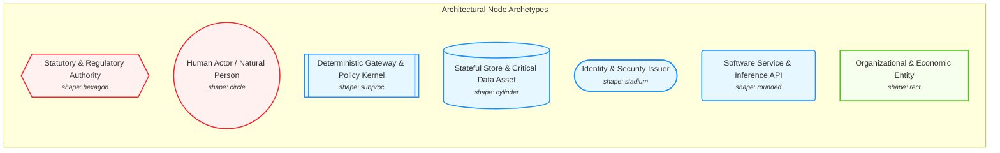
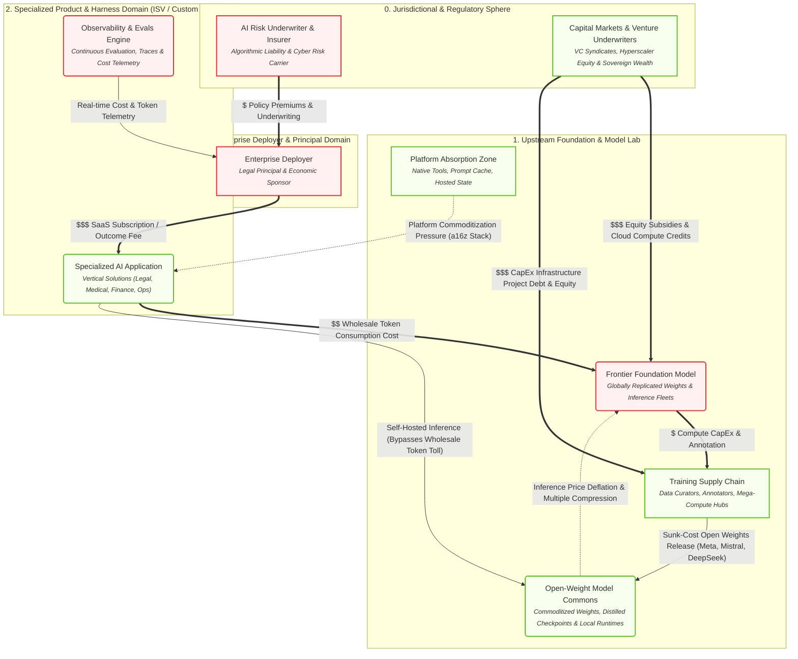
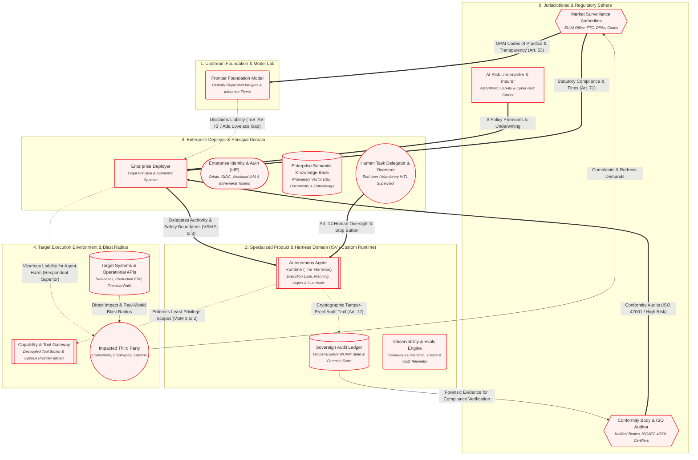
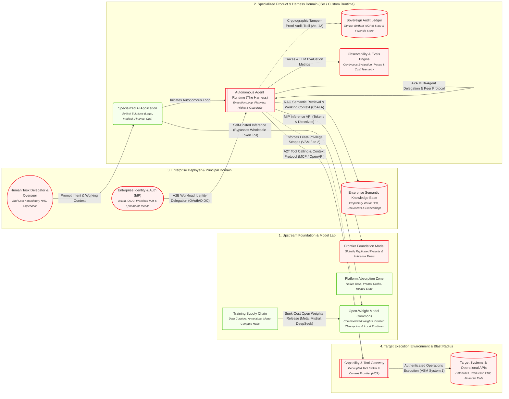

import useBaseUrl from '@docusaurus/useBaseUrl';
import Tabs from '@theme/Tabs';
import TabItem from '@theme/TabItem';

# AI Ecosystem: Multi-Lens Architecture & Governance

:::tip Download Canonical Models
Download the raw model to explore and query in external visual modeling tools:

- <a href={useBaseUrl("/exports/ai_ecosystem.graphml")} download="ai_ecosystem.graphml">**Download for yEd** (.graphml)</a>
- <a href={useBaseUrl("/exports/ai_ecosystem.drawio")} download="ai_ecosystem.drawio">**Download for draw.io** (.drawio)</a>
- <a href={useBaseUrl("/exports/ai_ecosystem_kumu.json")} download="ai_ecosystem_kumu.json">**Download for Kumu Blueprint** (.json)</a>
:::

<strong>📖 Visual Language & Architectural Key (Click to expand)</strong>

### Node Archetypes (Shapes)

| Shape | Archetype / Meaning | Description |
| :---: | :--- | :--- |
| `hexagon` | **Statutory & Regulatory Authority** | External legal jurisdictions, court systems, conformity auditors (non-negotiable authority). |
| `circle` | **Human Actor / Natural Person** | Human principals, operators (HITL), or impacted third-party individuals. |
| `subproc` | **Deterministic Gateway & Policy Kernel** | Sandboxes, policy harnesses, capability gateways where deterministic logic bounds AI. |
| `cylinder` | **Stateful Store & Critical Data Asset** | Append-only audit stores, vector databases, production databases, target ERPs. |
| `stadium` | **Identity & Security Issuer** | Enterprise IdP, OAuth token issuers, workload authorization brokers. |
| `rounded` | **Software Service & Inference API** | Frontier model endpoints, vertical applications, continuous eval engines. |
| `rect` | **Organizational & Economic Entity** | Commercial deployers, CapEx supply chain entities, market absorption zones. |

### Relationship & Edge Types

| Line Style | Relationship Type | Semantic Meaning |
| :---: | :--- | :--- |
| `== 'label' ==>` | **Capital / Commercial Flow** (`money`) | Financial transactions, SaaS subscriptions, compute CapEx, insurance premiums. |
| `== 'label' ==>` | **Direct Authority & Override** (`authority`) | Statutory mandates, legal agency delegation, mandatory human oversight. |
| `-. 'label' .->` | **Policy Constraint & Audit Trail** (`governance_control`) | Tamper-evident logging, scope enforcement, sandbox boundaries. |
| `-. 'label' .->` | **Liability & Market Tension** (`tension`) | Tort liability exposure, blast radius impact, platform commoditization pressure. |
| `-. 'label' .->` | **Contractual Disclaimer** (`disclaim`) | ToS liability carve-outs and 'AS-IS' warranty limitations. |
| `-->|'label'|` | **Technical Protocol** (`protocol`) | JSON-RPC tool calling, OAuth bearer flows, inference API calls, A2A delegation. |
| `-->|'label'|` | **Data & Intent Flow** (`flow`) | Prompt context, telemetry metrics, audit evidence submissions. |

### Domain Boundary Colors

| Color | Domain | Scope |
| :---: | :--- | :--- |
| 🔴 **Red / Pink** | `governance` | Statutory duties, liability allocation, compliance controls, human oversight. |
| 🟢 **Green** | `economic` | SaaS contracts, token consumption costs, GPU CapEx, underwriting fees. |
| 🔵 **Blue** | `technical` | API execution protocols, JSON-RPC (MCP), state persistence, telemetry. |

:::info Where is the "AI Agent" in this model?
An **AI Agent** is not a single monolithic entity or box. In this architecture, it is an **emergent composite loop** that arises when five distinct elements interact:

- 🧠 **The Brain (Reasoning Core)**: `Frontier Foundation Model` (`N_FRONTIER`) — Stateless next-token prediction and probabilistic planning.
- ⚙️ **The Controller & Drive Loop (The Ego)**: `Agent Governance Harness` (`N_HARNESS`) — The continuous while-loop, self-reflection, and deterministic policy guardrails.
- 📚 **The Memory (Semantic Context)**: `Enterprise Semantic Knowledge Base` (`N_KNOWLEDGE_STORE`) — Vector databases and private enterprise documents retrieved via RAG (CoALA architecture).
- 🛠️ **The Hands (Tool Actuation)**: `Capability & Tool Gateway` (`N_TOOL_GATEWAY`) $\to$ `Target Systems` (`N_TARGET_SYS`) — Decoupled tool broker (MCP / OpenAPI) executing real-world read/write operations.
- ⚖️ **The Principal (Legal Agency)**: `Enterprise Deployer` (`N_ENTERPRISE`) & `Human Delegator` (`N_HUMAN_USER`) — The legal entity that confers agency, issues workload credentials (`N_IDP`), and retains vicarious legal liability.
:::

### Interactive Lenses
Select a lens below to explore the ecosystem interactively:

<Tabs>
<TabItem value="view_economic" label="Executive & Economic Perspective">

*Capital allocation, SaaS margins, token cost exposure, and platform absorption (a16z & Sequoia Stack).*

</TabItem>
<TabItem value="view_governance_liability" label="Legal, Regulatory & Liability Perspective">

*The liability disconnect: upstream ToS disclaimers vs deployer vicarious liability and regulatory enforcement (Ada Lovelace & EU AI Act).*

</TabItem>
<TabItem value="view_technical_runtime" label="Engineering Lens: Autonomous Agent Loop & Protocol Architecture">

*Maps the anatomy of an agent: how the runtime harness coordinates reasoning (MIP), memory (CoALA RAG), multi-agent delegation (A2A), and tool execution (A2T).*

</TabItem>
<TabItem value="view_full_unified" label="Unified Ecosystem Model">

*The complete property graph combining economic flows, technical loops, and cybernetic governance gates (VSM Systems 1–5).*

```mermaid
flowchart TB
    classDef gov fill:#FFF1F0,stroke:#F5222D,stroke-width:2px;
    classDef econ fill:#F6FFED,stroke:#52C41A,stroke-width:2px;
    classDef tech fill:#E6F7FF,stroke:#1890FF,stroke-width:2px;
    classDef default fill:#F8FAFC,stroke:#64748B,stroke-width:1.5px;

    subgraph cluster_regulatory ["0. Jurisdictional & Regulatory Sphere"]
        N_REGULATOR{{"Market Surveillance Authorities<br/><small><i>EU AI Office, FTC, DPAs, Courts</i></small>"}}:::gov
        N_AUDITOR{{"Conformity Body &amp; ISO Auditor<br/><small><i>Notified Bodies, ISO/IEC 42001 Certifiers</i></small>"}}:::gov
        N_INSURER["AI Risk Underwriter &amp; Insurer<br/><small><i>Algorithmic Liability &amp; Cyber Risk Carrier</i></small>"]:::gov
        N_CAPITAL["Capital Markets &amp; Venture Underwriters<br/><small><i>VC Syndicates, Hyperscaler Equity &amp; Sovereign Wealth</i></small>"]:::econ
    end

    subgraph cluster_supply ["1. Upstream Foundation & Model Lab"]
        N_TRAIN["Training Supply Chain<br/><small><i>Data Curators, Annotators, Mega-Compute Hubs</i></small>"]:::econ
        N_FRONTIER("Frontier Foundation Model<br/><small><i>Globally Replicated Weights &amp; Inference Fleets</i></small>"):::gov
        N_ABSORBED["Platform Absorption Zone<br/><small><i>Native Tools, Prompt Cache, Hosted State</i></small>"]:::econ
        N_OPEN_MODEL("Open-Weight Model Commons<br/><small><i>Commoditized Weights, Distilled Checkpoints &amp; Local Runtimes</i></small>"):::econ
    end

    subgraph cluster_product ["2. Specialized Product & Harness Domain (ISV / Custom Runtime)"]
        N_ISV_PRODUCT("Specialized AI Application<br/><small><i>Vertical Solutions (Legal, Medical, Finance, Ops)</i></small>"):::econ
        N_HARNESS[["Autonomous Agent Runtime (The Harness)<br/><small><i>Execution Loop, Planning, Rights &amp; Guardrails</i></small>"]]:::gov
        N_AUDIT_STORE[("Sovereign Audit Ledger<br/><small><i>Tamper-Evident WORM State &amp; Forensic Store</i></small>")]:::gov
        N_OBSERVE("Observability &amp; Evals Engine<br/><small><i>Continuous Evaluation, Traces &amp; Cost Telemetry</i></small>"):::gov
    end

    subgraph cluster_client ["3. Enterprise Deployer & Principal Domain"]
        N_ENTERPRISE["Enterprise Deployer<br/><small><i>Legal Principal &amp; Economic Sponsor</i></small>"]:::gov
        N_IDP(["Enterprise Identity &amp; Auth (IdP)<br/><small><i>OAuth, OIDC, Workload IAM &amp; Ephemeral Tokens</i></small>"]):::gov
        N_KNOWLEDGE_STORE[("Enterprise Semantic Knowledge Base<br/><small><i>Proprietary Vector DBs, Documents &amp; Embeddings</i></small>")]:::gov
        N_HUMAN_USER(("Human Task Delegator &amp; Overseer<br/><small><i>End User / Mandatory HITL Supervisor</i></small>")):::gov
    end

    subgraph cluster_environment ["4. Target Execution Environment & Blast Radius"]
        N_TOOL_GATEWAY[["Capability &amp; Tool Gateway<br/><small><i>Decoupled Tool Broker &amp; Context Provider (MCP)</i></small>"]]:::gov
        N_TARGET_SYS[("Target Systems &amp; Operational APIs<br/><small><i>Databases, Production ERP, Financial Rails</i></small>")]:::gov
        N_AFFECTED_PARTY(("Impacted Third Party<br/><small><i>Consumers, Employees, Citizens</i></small>")):::gov
    end

    N_ENTERPRISE == "$$$ SaaS Subscription / Outcome Fee" ==> N_ISV_PRODUCT
    N_ISV_PRODUCT == "$$ Wholesale Token Consumption Cost" ==> N_FRONTIER
    N_FRONTIER == "$ Compute CapEx & Annotation" ==> N_TRAIN
    N_ABSORBED -. "Platform Commoditization Pressure (a16z Stack)" .-> N_ISV_PRODUCT
    N_INSURER == "$ Policy Premiums & Underwriting" ==> N_ENTERPRISE
    N_OBSERVE -->|"Real-time Cost & Token Telemetry"| N_ENTERPRISE
    N_CAPITAL == "$$$ Equity Subsidies & Cloud Compute Credits" ==> N_FRONTIER
    N_CAPITAL == "$$$ CapEx Infrastructure Project Debt & Equity" ==> N_TRAIN
    N_TRAIN -->|"Sunk-Cost Open Weights Release (Meta, Mistral, DeepSeek)"| N_OPEN_MODEL
    N_OPEN_MODEL -. "Inference Price Deflation & Multiple Compression" .-> N_FRONTIER
    N_ISV_PRODUCT -->|"Self-Hosted Inference (Bypasses Wholesale Token Toll)"| N_OPEN_MODEL
    N_REGULATOR == "Statutory Compliance & Fines (Art. 71)" ==> N_ENTERPRISE
    N_REGULATOR == "GPAI Codes of Practice & Transparency (Art. 53)" ==> N_FRONTIER
    N_AUDITOR == "Conformity Audits (ISO 42001 / High Risk)" ==> N_ENTERPRISE
    N_FRONTIER -. "Disclaims Liability (ToS 'AS-IS' / Ada Lovelace Gap)" .-> N_ENTERPRISE
    N_ENTERPRISE -. "Vicarious Liability for Agent Harm (Respondeat Superior)" .-> N_AFFECTED_PARTY
    N_AFFECTED_PARTY -->|"Complaints & Redress Demands"| N_REGULATOR
    N_ENTERPRISE == "Delegates Authority & Safety Boundaries (VSM 5 to 3)" ==> N_HARNESS
    N_HUMAN_USER == "Art. 14 Human Oversight & Stop Button" ==> N_HARNESS
    N_HARNESS -. "Cryptographic Tamper-Proof Audit Trail (Art. 12)" .-> N_AUDIT_STORE
    N_AUDIT_STORE -->|"Forensic Evidence for Compliance Verification"| N_AUDITOR
    N_HARNESS -. "Enforces Least-Privilege Scopes (VSM 3 to 2)" .-> N_TOOL_GATEWAY
    N_TARGET_SYS -. "Direct Impact & Real-World Blast Radius" .-> N_AFFECTED_PARTY
    N_HUMAN_USER -->|"Prompt Intent & Working Context"| N_ISV_PRODUCT
    N_IDP -->|"A2E Workload Identity Delegation (OAuth/OIDC)"| N_HARNESS
    N_ISV_PRODUCT -->|"Initiates Autonomous Loop"| N_HARNESS
    N_HARNESS -->|"MIP Inference API (Tokens & Directives)"| N_FRONTIER
    N_HARNESS -->|"RAG Semantic Retrieval & Working Context (CoALA)"| N_KNOWLEDGE_STORE
    N_HARNESS -->|"A2A Multi-Agent Delegation & Peer Protocol"| N_HARNESS
    N_HARNESS -->|"Traces & LLM Evaluation Metrics"| N_OBSERVE
    N_HARNESS -->|"A2T Tool Calling & Context Protocol (MCP / OpenAPI)"| N_TOOL_GATEWAY
    N_TOOL_GATEWAY -->|"Authenticated Operations Execution (VSM System 1)"| N_TARGET_SYS
```

</TabItem>
</Tabs>

## Canonical Element Dictionary

| Element | Cluster | Domains | Properties |
| :--- | :--- | :--- | :--- |
| **Market Surveillance Authorities** <small>EU AI Office, FTC, DPAs, Courts</small> `N_REGULATOR` | 0. Jurisdictional & Regulatory Sphere | governance | **cardinality**: 10^1 Jurisdictional Bodies **enforcement_powers**: Fines up to 7% global turnover, stop orders **vsm_tier**: System 5 (External Statutory Meta-System) **nist_function**: GOVERN |
| **Conformity Body & ISO Auditor** <small>Notified Bodies, ISO/IEC 42001 Certifiers</small> `N_AUDITOR` | 0. Jurisdictional & Regulatory Sphere | governance | **cardinality**: 10^2 Accredited Audit Entities **role**: CE conformity assessments & continuous surveillance **vsm_tier**: System 3* (Sporadic External Audit) **nist_function**: MEASURE |
| **AI Risk Underwriter & Insurer** <small>Algorithmic Liability & Cyber Risk Carrier</small> `N_INSURER` | 0. Jurisdictional & Regulatory Sphere | economic, governance | **cardinality**: 10^2 Global Underwriters **underwriting_gate**: Requires verifiable audit trail & human oversight **vsm_tier**: System 3 (Economic Viability Gate) **nist_function**: MANAGE |
| **Capital Markets & Venture Underwriters** <small>VC Syndicates, Hyperscaler Equity & Sovereign Wealth</small> `N_CAPITAL` | 0. Jurisdictional & Regulatory Sphere | economic | **cardinality**: 10^2 Global Mega-Funds & Hyperscaler Treasuries **financing_role**: Subsidizes CapEx overhang & absorbs initial operating losses **hurdle_rate**: Demands hyper-scale equity returns ($600B AI Question) **vsm_tier**: System 5 (Macro Financial Sponsorship) **nist_function**: GOVERN |
| **Training Supply Chain** <small>Data Curators, Annotators, Mega-Compute Hubs</small> `N_TRAIN` | 1. Upstream Foundation & Model Lab | economic, technical | **cardinality**: Top 5-10 Global Mega-Campuses **compute_profile**: Concentrated 50k-100k+ GPU clusters; GW-scale power **cost_type**: Fixed / Heavy CapEx ($600B Infrastructure Question) **ip_risk**: Copyright infringement / scraping litigation **vsm_tier**: System 1 (Upstream Production) **nist_function**: MAP |
| **Frontier Foundation Model** <small>Globally Replicated Weights & Inference Fleets</small> `N_FRONTIER` | 1. Upstream Foundation & Model Lab | economic, technical, governance | **cardinality**: Top 5-10 Labs; Replicated across 10^3 Regional Clusters **compute_profile**: High memory-bandwidth inference clusters; low latency **sovereignty_gap**: Physical data residency does not equal jurisdictional independence **eu_ai_act_role**: Provider_GPAI **pricing_model**: Wholesale Per-Token Usage **liability_posture**: Disclaimed via ToS ('AS-IS') **vsm_tier**: System 4 (Probabilistic Intelligence Engine) **nist_function**: MEASURE |
| **Platform Absorption Zone** <small>Native Tools, Prompt Cache, Hosted State</small> `N_ABSORBED` | 1. Upstream Foundation & Model Lab | economic, technical | **cardinality**: Top 3-5 Cloud Ecosystems **market_effect**: Feature commoditization of wrapper ISVs (a16z Stack) **vsm_tier**: System 4 (Environmental Encroachment) |
| **Open-Weight Model Commons** <small>Commoditized Weights, Distilled Checkpoints & Local Runtimes</small> `N_OPEN_MODEL` | 1. Upstream Foundation & Model Lab | economic, technical | **cardinality**: 10^2 Viable Open Foundation Checkpoints **pricing_model**: Zero Marginal License Cost (Commoditized Inference) **hosting_model**: Raw Compute Lease or On-Premise GPU Fleets **market_effect**: Deflates proprietary per-token pricing power **vsm_tier**: System 4 (Commoditized Commons Intelligence) **nist_function**: MAP |
| **Specialized AI Application** <small>Vertical Solutions (Legal, Medical, Finance, Ops)</small> `N_ISV_PRODUCT` | 2. Specialized Product & Harness Domain (ISV / Custom Runtime) | economic, technical | **cardinality**: 10^4 - 10^5 Vertical SaaS Products **eu_ai_act_role**: Provider_System **pricing_model**: Per-Seat SaaS / Value-Added Outcome Fee **margin_exposure**: Squeezed between token costs & platform absorption **vsm_tier**: System 4 (Operational Domain Intelligence) **nist_function**: MAP |
| **Autonomous Agent Runtime (The Harness)** <small>Execution Loop, Planning, Rights & Guardrails</small> `N_HARNESS` | 2. Specialized Product & Harness Domain (ISV / Custom Runtime) | technical, governance | **cardinality**: 10^7 - 10^9 Ephemeral Agent Invocations **compute_profile**: Lightweight CPU / Orchestration Logic **iso_42001_role**: AIMS Technical Control Implementation **duty_of_care**: Caps blast radius, halts unsafe prompts/actions **coala_role**: Action Execution Engine & Procedural Memory Guard **anthropic_pattern**: Decoupled Orchestrator-Worker & Gate **vsm_tier**: System 3 (Internal Operational Control & Stability) **nist_function**: MANAGE |
| **Sovereign Audit Ledger** <small>Tamper-Evident WORM State & Forensic Store</small> `N_AUDIT_STORE` | 2. Specialized Product & Harness Domain (ISV / Custom Runtime) | technical, governance | **cardinality**: 10^4 Enterprise Sovereign Ledgers **compliance**: Art. 12 Mandatory Logging / Rebuttal of Fault **sovereignty**: Client / Enterprise Owned **evidentiary_role**: Black-Box Flight Recorder for Liability Disputes **vsm_tier**: System 3* (Internal Audit Channel) **nist_function**: MEASURE |
| **Observability & Evals Engine** <small>Continuous Evaluation, Traces & Cost Telemetry</small> `N_OBSERVE` | 2. Specialized Product & Harness Domain (ISV / Custom Runtime) | technical, governance, economic | **cardinality**: 10^4 Monitoring Pipelines **capabilities**: LLM-as-a-judge, OTEL tracing, token telemetry **vsm_tier**: System 3 (Performance Monitoring & Homeostasis) **nist_function**: MEASURE |
| **Enterprise Deployer** <small>Legal Principal & Economic Sponsor</small> `N_ENTERPRISE` | 3. Enterprise Deployer & Principal Domain | economic, governance | **cardinality**: 10^5 Commercial Deployers Globally **eu_ai_act_role**: Deployer **liability_posture**: Holds Vicarious & Strict Legal Liability **roi_hurdle**: High CapEx Recovery Pressure (Sequoia Act Two) **vsm_tier**: System 5 (Corporate Policy & Ultimate Governance) **nist_function**: GOVERN |
| **Enterprise Identity & Auth (IdP)** <small>OAuth, OIDC, Workload IAM & Ephemeral Tokens</small> `N_IDP` | 3. Enterprise Deployer & Principal Domain | technical, governance | **cardinality**: 10^5 Enterprise Directories **security_role**: Issues scoped actor delegations to agents (A2E) **vsm_tier**: System 2 (Security Coordination) **nist_function**: MANAGE |
| **Enterprise Semantic Knowledge Base** <small>Proprietary Vector DBs, Documents & Embeddings</small> `N_KNOWLEDGE_STORE` | 3. Enterprise Deployer & Principal Domain | technical, governance | **cardinality**: 10^5 Private Knowledge Bases **coala_memory_type**: Semantic Memory (Factual & Document Knowledge) **sovereignty**: Enterprise Controlled / Private Boundary **vsm_tier**: System 1 (Knowledge Asset) **nist_function**: MAP |
| **Human Task Delegator & Overseer** <small>End User / Mandatory HITL Supervisor</small> `N_HUMAN_USER` | 3. Enterprise Deployer & Principal Domain | technical, governance | **cardinality**: 10^8 End Users & Operators **control_mode**: Prompting, Art. 14 Human Oversight, Override **vsm_tier**: System 5 (Human Intent & Final Agency) **nist_function**: GOVERN |
| **Capability & Tool Gateway** <small>Decoupled Tool Broker & Context Provider (MCP)</small> `N_TOOL_GATEWAY` | 4. Target Execution Environment & Blast Radius | technical, governance | **cardinality**: 10^4 - 10^5 Gateway Servers **protocol_standards**: Model Context Protocol (MCP), OpenAPI, GraphQL (A2T) **security_role**: Tool discovery, sandbox isolation, scope negotiation **vsm_tier**: System 2 (Coordination & Oscillation Damping) **nist_function**: MANAGE |
| **Target Systems & Operational APIs** <small>Databases, Production ERP, Financial Rails</small> `N_TARGET_SYS` | 4. Target Execution Environment & Blast Radius | technical, governance | **cardinality**: 10^6 Production Systems Globally **risk_zone**: Direct Causation Blast Radius **vsm_tier**: System 1 (Real-World Actuation & Operations) **nist_function**: MANAGE |
| **Impacted Third Party** <small>Consumers, Employees, Citizens</small> `N_AFFECTED_PARTY` | 4. Target Execution Environment & Blast Radius | governance | **cardinality**: Billions of Impacted Individuals **eu_ai_act_role**: Affected_Subject **legal_standing**: Private Right of Action, Tort Plaintiff, Data Subject **vsm_tier**: External Environment (Ultimate Impact Receptor) |