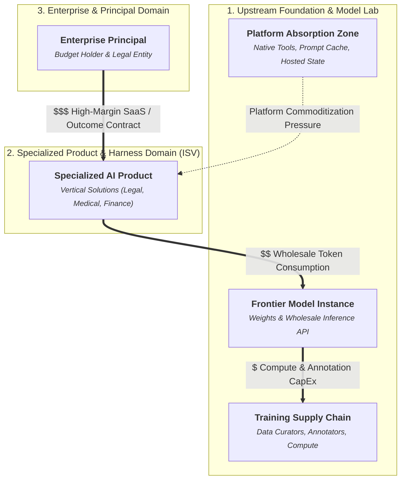
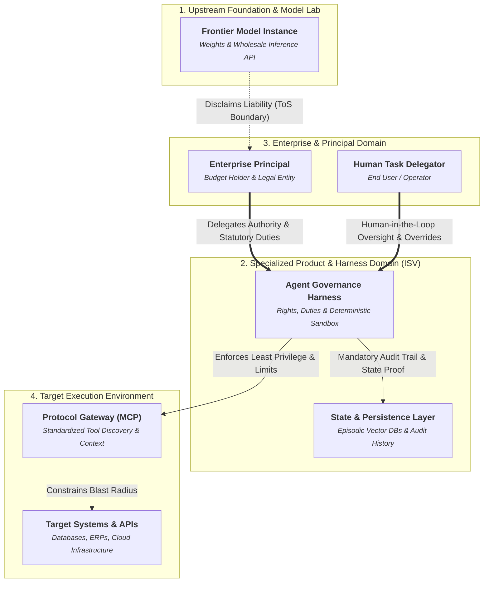

# AI Ecosystem: Multi-Lens Architecture & Governance

Select a lens below to explore the ecosystem. You can also download the raw models for visual editing in **yEd** or **draw.io**.

import Tabs from '@theme/Tabs';
import TabItem from '@theme/TabItem';

<Tabs>
<TabItem value="view_economic" label="Executive & Economic View (Value Flows & Commoditization)">

> 📥 **Export to Graphical Tools:** 
> <a href="pathname:///ai-ecosystem-model/exports/view_economic.graphml" download>Download for yEd (.graphml)</a> &nbsp;|&nbsp; 
> <a href="pathname:///ai-ecosystem-model/exports/view_economic.drawio" download>Download for draw.io (.drawio)</a>

</TabItem>
<TabItem value="view_governance" label="Governance, Rights & Liability View">

> 📥 **Export to Graphical Tools:** 
> <a href="pathname:///ai-ecosystem-model/exports/view_governance.graphml" download>Download for yEd (.graphml)</a> &nbsp;|&nbsp; 
> <a href="pathname:///ai-ecosystem-model/exports/view_governance.drawio" download>Download for draw.io (.drawio)</a>

</TabItem>
</Tabs>

## Canonical Element Dictionary

| Element | Domains | Properties |
| :--- | :--- | :--- |
| **Training Supply Chain** `N_TRAIN` | economic, technical | **cost_type**: Fixed / R&D CapEx |
| **Frontier Model Instance** `N_FRONTIER` | economic, technical, governance | **pricing_model**: Per-Token Usage **liability_posture**: Disclaimed via ToS |
| **Platform Absorption Zone** `N_ABSORBED` | economic, technical | **market_effect**: Encroachment on ISVs |
| **Specialized AI Product** `N_ISV_PRODUCT` | economic, technical | **pricing_model**: SaaS Seat / Outcome Pricing **margin_profile**: High Gross Margin (Vulnerable) |
| **Agent Governance Harness** `N_HARNESS` | technical, governance | **enforcement**: Deterministic Policies & Budgets **audit_role**: Sovereign Audit Ledger |
| **State & Persistence Layer** `N_MEMORY` | technical, governance | **sovereignty**: Client / Enterprise Owned **compliance**: GDPR / Audit Logging |
| **Enterprise Principal** `N_ENTERPRISE` | economic, governance | **liability_posture**: Holds Vicarious Legal Liability **commercial_role**: Economic Sponsor |
| **Human Task Delegator** `N_HUMAN_USER` | technical, governance | **control_mode**: Prompting & HITL Approvals |
| **Protocol Gateway (MCP)** `N_MCP_HOST` | technical, governance | **protocol_standard**: Model Context Protocol **security**: Scope Negotiation |
| **Target Systems & APIs** `N_TARGET_SYS` | technical, governance | **risk_zone**: Blast Radius **access_control**: RBAC / Least Privilege |