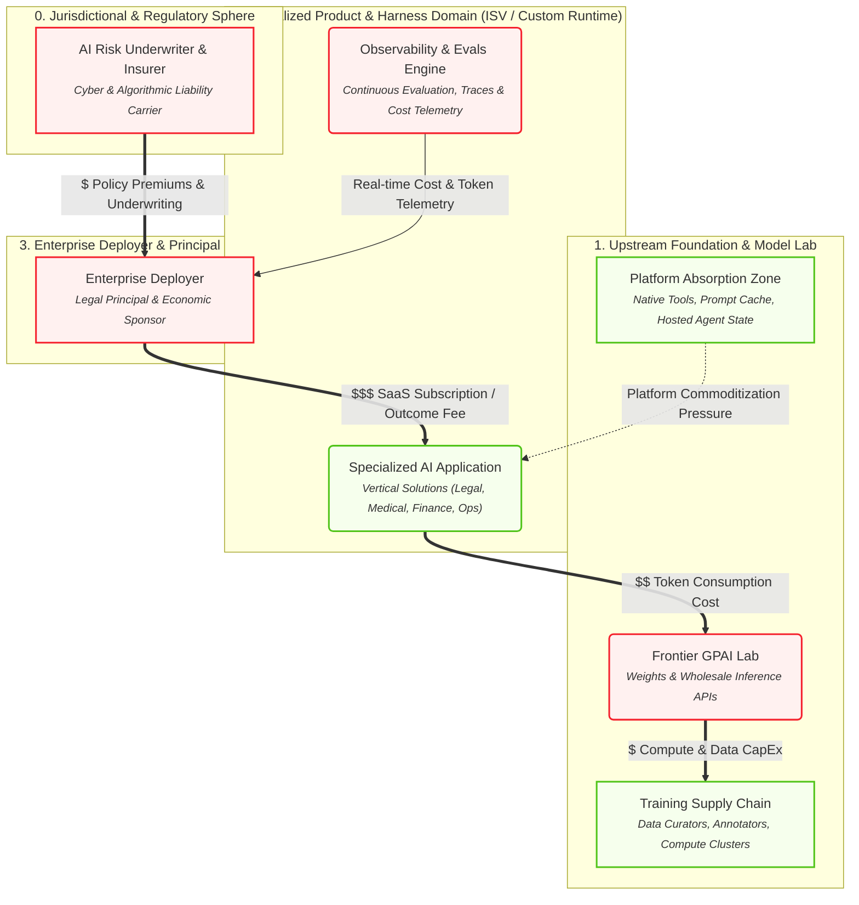
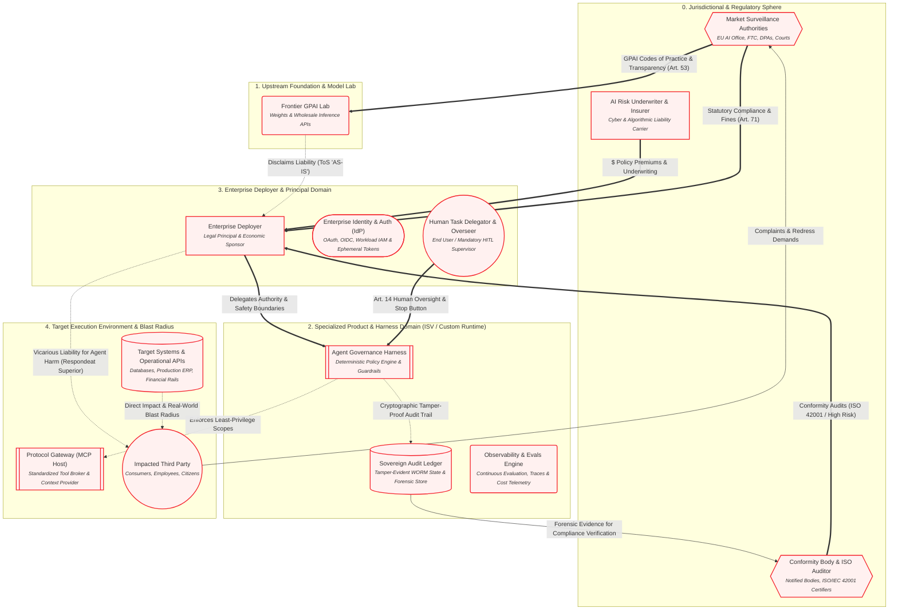
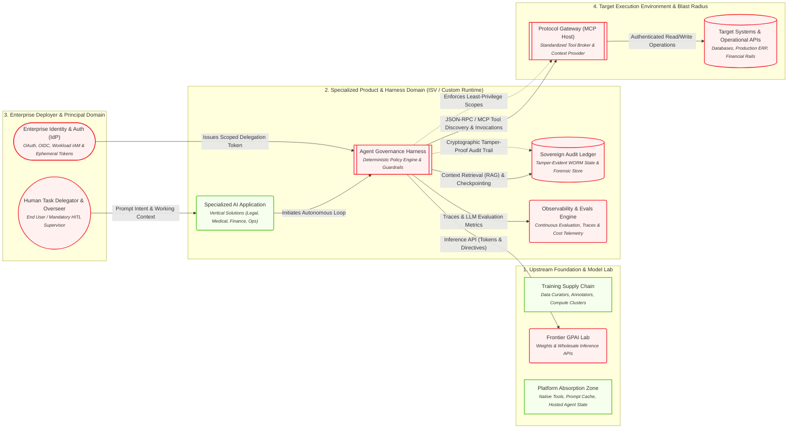

# AI Ecosystem: Multi-Lens Architecture & Governance

> [DOWNLOADS] Canonical Models for Visual Modeling Tools:  
> <a href="pathname:///ai-ecosystem-model/exports/ai_ecosystem.graphml" download>Download for yEd (.graphml)</a> &nbsp;|&nbsp; 
> <a href="pathname:///ai-ecosystem-model/exports/ai_ecosystem.drawio" download>Download for draw.io (.drawio)</a> &nbsp;|&nbsp; 
> <a href="pathname:///ai-ecosystem-model/exports/ai_ecosystem_kumu.csv" download>Download for Kumu (.csv)</a>

Select a lens below to explore the ecosystem interactively:

import Tabs from '@theme/Tabs';
import TabItem from '@theme/TabItem';

<Tabs>
<TabItem value="view_economic" label="Executive & Economic Perspective">

*Capital allocation, SaaS margins, token cost exposure, and platform absorption.*

</TabItem>
<TabItem value="view_governance_liability" label="Legal, Regulatory & Liability Perspective">

*The liability disconnect: upstream ToS disclaimers vs deployer vicarious liability and regulatory enforcement.*

</TabItem>
<TabItem value="view_technical_runtime" label="Engineering & Technical Runtime Perspective">

*The agentic execution loop: IdP delegation, inference protocols, MCP gateways, and state stores.*

</TabItem>
<TabItem value="view_full_unified" label="Unified Ecosystem Model">

*The complete property graph combining economic flows, technical loops, and governance gates.*

```mermaid
flowchart TB
    classDef gov fill:#FFF1F0,stroke:#F5222D,stroke-width:2px;
    classDef econ fill:#F6FFED,stroke:#52C41A,stroke-width:2px;
    classDef tech fill:#E6F7FF,stroke:#1890FF,stroke-width:2px;
    classDef default fill:#F8FAFC,stroke:#64748B,stroke-width:1.5px;

    subgraph cluster_regulatory ["0. Jurisdictional & Regulatory Sphere"]
        N_REGULATOR{{"Market Surveillance Authorities<br/><small><i>EU AI Office, FTC, DPAs, Courts</i></small>"}}:::gov
        N_AUDITOR{{"Conformity Body &amp; ISO Auditor<br/><small><i>Notified Bodies, ISO/IEC 42001 Certifiers</i></small>"}}:::gov
        N_INSURER["AI Risk Underwriter &amp; Insurer<br/><small><i>Cyber &amp; Algorithmic Liability Carrier</i></small>"]:::gov
    end

    subgraph cluster_supply ["1. Upstream Foundation & Model Lab"]
        N_TRAIN["Training Supply Chain<br/><small><i>Data Curators, Annotators, Compute Clusters</i></small>"]:::econ
        N_FRONTIER("Frontier GPAI Lab<br/><small><i>Weights &amp; Wholesale Inference APIs</i></small>"):::gov
        N_ABSORBED["Platform Absorption Zone<br/><small><i>Native Tools, Prompt Cache, Hosted Agent State</i></small>"]:::econ
    end

    subgraph cluster_product ["2. Specialized Product & Harness Domain (ISV / Custom Runtime)"]
        N_ISV_PRODUCT("Specialized AI Application<br/><small><i>Vertical Solutions (Legal, Medical, Finance, Ops)</i></small>"):::econ
        N_HARNESS[["Agent Governance Harness<br/><small><i>Deterministic Policy Engine &amp; Guardrails</i></small>"]]:::gov
        N_AUDIT_STORE[("Sovereign Audit Ledger<br/><small><i>Tamper-Evident WORM State &amp; Forensic Store</i></small>")]:::gov
        N_OBSERVE("Observability &amp; Evals Engine<br/><small><i>Continuous Evaluation, Traces &amp; Cost Telemetry</i></small>"):::gov
    end

    subgraph cluster_client ["3. Enterprise Deployer & Principal Domain"]
        N_ENTERPRISE["Enterprise Deployer<br/><small><i>Legal Principal &amp; Economic Sponsor</i></small>"]:::gov
        N_IDP(["Enterprise Identity &amp; Auth (IdP)<br/><small><i>OAuth, OIDC, Workload IAM &amp; Ephemeral Tokens</i></small>"]):::gov
        N_HUMAN_USER(("Human Task Delegator &amp; Overseer<br/><small><i>End User / Mandatory HITL Supervisor</i></small>")):::gov
    end

    subgraph cluster_environment ["4. Target Execution Environment & Blast Radius"]
        N_MCP_HOST[["Protocol Gateway (MCP Host)<br/><small><i>Standardized Tool Broker &amp; Context Provider</i></small>"]]:::gov
        N_TARGET_SYS[("Target Systems &amp; Operational APIs<br/><small><i>Databases, Production ERP, Financial Rails</i></small>")]:::gov
        N_AFFECTED_PARTY(("Impacted Third Party<br/><small><i>Consumers, Employees, Citizens</i></small>")):::gov
    end

    N_ENTERPRISE == "$$$ SaaS Subscription / Outcome Fee" ==> N_ISV_PRODUCT
    N_ISV_PRODUCT == "$$ Token Consumption Cost" ==> N_FRONTIER
    N_FRONTIER == "$ Compute & Data CapEx" ==> N_TRAIN
    N_ABSORBED -. "Platform Commoditization Pressure" .-> N_ISV_PRODUCT
    N_INSURER == "$ Policy Premiums & Underwriting" ==> N_ENTERPRISE
    N_OBSERVE -->|"Real-time Cost & Token Telemetry"| N_ENTERPRISE
    N_REGULATOR == "Statutory Compliance & Fines (Art. 71)" ==> N_ENTERPRISE
    N_REGULATOR == "GPAI Codes of Practice & Transparency (Art. 53)" ==> N_FRONTIER
    N_AUDITOR == "Conformity Audits (ISO 42001 / High Risk)" ==> N_ENTERPRISE
    N_FRONTIER -. "Disclaims Liability (ToS 'AS-IS')" .-> N_ENTERPRISE
    N_ENTERPRISE -. "Vicarious Liability for Agent Harm (Respondeat Superior)" .-> N_AFFECTED_PARTY
    N_AFFECTED_PARTY -->|"Complaints & Redress Demands"| N_REGULATOR
    N_ENTERPRISE == "Delegates Authority & Safety Boundaries" ==> N_HARNESS
    N_HUMAN_USER == "Art. 14 Human Oversight & Stop Button" ==> N_HARNESS
    N_HARNESS -. "Cryptographic Tamper-Proof Audit Trail" .-> N_AUDIT_STORE
    N_AUDIT_STORE -->|"Forensic Evidence for Compliance Verification"| N_AUDITOR
    N_HARNESS -. "Enforces Least-Privilege Scopes" .-> N_MCP_HOST
    N_TARGET_SYS -. "Direct Impact & Real-World Blast Radius" .-> N_AFFECTED_PARTY
    N_HUMAN_USER -->|"Prompt Intent & Working Context"| N_ISV_PRODUCT
    N_IDP -->|"Issues Scoped Delegation Token"| N_HARNESS
    N_ISV_PRODUCT -->|"Initiates Autonomous Loop"| N_HARNESS
    N_HARNESS -->|"Inference API (Tokens & Directives)"| N_FRONTIER
    N_HARNESS -->|"Context Retrieval (RAG) & Checkpointing"| N_AUDIT_STORE
    N_HARNESS -->|"Traces & LLM Evaluation Metrics"| N_OBSERVE
    N_HARNESS -->|"JSON-RPC / MCP Tool Discovery & Invocations"| N_MCP_HOST
    N_MCP_HOST -->|"Authenticated Read/Write Operations"| N_TARGET_SYS
```

</TabItem>
</Tabs>

## Canonical Element Dictionary

| Element | Cluster | Domains | Properties |
| :--- | :--- | :--- | :--- |
| **Market Surveillance Authorities** <small>EU AI Office, FTC, DPAs, Courts</small> `N_REGULATOR` | 0. Jurisdictional & Regulatory Sphere | governance | **enforcement_powers**: Fines up to 7% turnover, injunctions |
| **Conformity Body & ISO Auditor** <small>Notified Bodies, ISO/IEC 42001 Certifiers</small> `N_AUDITOR` | 0. Jurisdictional & Regulatory Sphere | governance | **role**: AIMS certification & post-market monitoring |
| **AI Risk Underwriter & Insurer** <small>Cyber & Algorithmic Liability Carrier</small> `N_INSURER` | 0. Jurisdictional & Regulatory Sphere | economic, governance | **underwriting_gate**: Requires verifiable audit trail & human oversight |
| **Training Supply Chain** <small>Data Curators, Annotators, Compute Clusters</small> `N_TRAIN` | 1. Upstream Foundation & Model Lab | economic, technical | **cost_type**: Fixed / Heavy R&D CapEx **ip_risk**: Copyright / Scraping litigation |
| **Frontier GPAI Lab** <small>Weights & Wholesale Inference APIs</small> `N_FRONTIER` | 1. Upstream Foundation & Model Lab | economic, technical, governance | **eu_ai_act_role**: Provider_GPAI **pricing_model**: Per-Token Usage **liability_posture**: Disclaimed via ToS ('AS-IS') |
| **Platform Absorption Zone** <small>Native Tools, Prompt Cache, Hosted Agent State</small> `N_ABSORBED` | 1. Upstream Foundation & Model Lab | economic, technical | **market_effect**: Feature commoditization of wrapper ISVs |
| **Specialized AI Application** <small>Vertical Solutions (Legal, Medical, Finance, Ops)</small> `N_ISV_PRODUCT` | 2. Specialized Product & Harness Domain (ISV / Custom Runtime) | economic, technical | **eu_ai_act_role**: Provider_System **pricing_model**: SaaS Seat / Value Outcome |
| **Agent Governance Harness** <small>Deterministic Policy Engine & Guardrails</small> `N_HARNESS` | 2. Specialized Product & Harness Domain (ISV / Custom Runtime) | technical, governance | **iso_42001_role**: AIMS Technical Control Implementation **duty_of_care**: Caps blast radius, halts unsafe prompts/actions |
| **Sovereign Audit Ledger** <small>Tamper-Evident WORM State & Forensic Store</small> `N_AUDIT_STORE` | 2. Specialized Product & Harness Domain (ISV / Custom Runtime) | technical, governance | **compliance**: Art. 12 Mandatory Logging / Rebuttal of Fault **sovereignty**: Client / Enterprise Owned |
| **Observability & Evals Engine** <small>Continuous Evaluation, Traces & Cost Telemetry</small> `N_OBSERVE` | 2. Specialized Product & Harness Domain (ISV / Custom Runtime) | technical, governance, economic | **capabilities**: LLM-as-a-judge, OTEL tracing, token cost tracking |
| **Enterprise Deployer** <small>Legal Principal & Economic Sponsor</small> `N_ENTERPRISE` | 3. Enterprise Deployer & Principal Domain | economic, governance | **eu_ai_act_role**: Deployer **liability_posture**: Holds Vicarious & Strict Liability |
| **Enterprise Identity & Auth (IdP)** <small>OAuth, OIDC, Workload IAM & Ephemeral Tokens</small> `N_IDP` | 3. Enterprise Deployer & Principal Domain | technical, governance | **security_role**: Issues scoped actor delegations to agents |
| **Human Task Delegator & Overseer** <small>End User / Mandatory HITL Supervisor</small> `N_HUMAN_USER` | 3. Enterprise Deployer & Principal Domain | technical, governance | **control_mode**: Prompting, Art. 14 Human Oversight, Override |
| **Protocol Gateway (MCP Host)** <small>Standardized Tool Broker & Context Provider</small> `N_MCP_HOST` | 4. Target Execution Environment & Blast Radius | technical, governance | **protocol_standard**: Model Context Protocol (MCP) **isolation**: Dynamic capability & permission negotiation |
| **Target Systems & Operational APIs** <small>Databases, Production ERP, Financial Rails</small> `N_TARGET_SYS` | 4. Target Execution Environment & Blast Radius | technical, governance | **risk_zone**: Direct Causation Blast Radius |
| **Impacted Third Party** <small>Consumers, Employees, Citizens</small> `N_AFFECTED_PARTY` | 4. Target Execution Environment & Blast Radius | governance | **eu_ai_act_role**: Affected_Subject **legal_standing**: Private right of action, tort claimant |