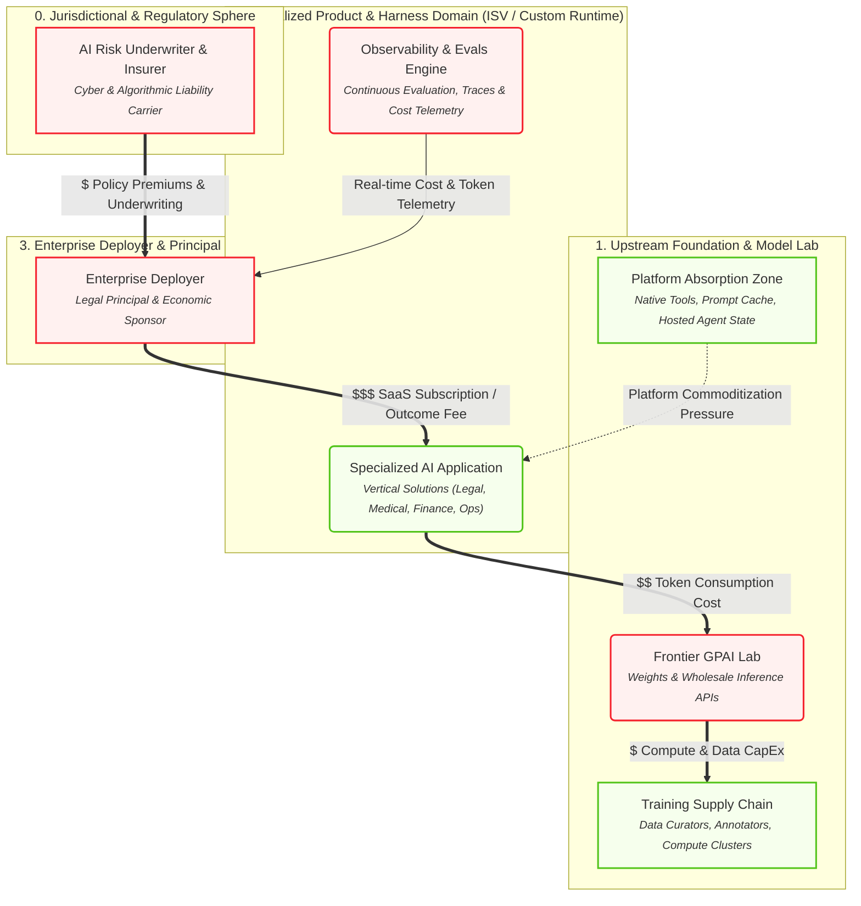

# Executive & Economic Perspective

> Capital allocation, SaaS margins, token cost exposure, and platform absorption.

## Architecture Diagram

## Active Elements in this Lens

| Element | Cluster | Operational Role & Properties |
| :--- | :--- | :--- |
| **AI Risk Underwriter & Insurer** <small>Cyber & Algorithmic Liability Carrier</small> `N_INSURER` | 0. Jurisdictional & Regulatory Sphere | **underwriting_gate**: Requires verifiable audit trail & human oversight |
| **Training Supply Chain** <small>Data Curators, Annotators, Compute Clusters</small> `N_TRAIN` | 1. Upstream Foundation & Model Lab | **cost_type**: Fixed / Heavy R&D CapEx **ip_risk**: Copyright / Scraping litigation |
| **Frontier GPAI Lab** <small>Weights & Wholesale Inference APIs</small> `N_FRONTIER` | 1. Upstream Foundation & Model Lab | **eu_ai_act_role**: Provider_GPAI **pricing_model**: Per-Token Usage **liability_posture**: Disclaimed via ToS ('AS-IS') |
| **Platform Absorption Zone** <small>Native Tools, Prompt Cache, Hosted Agent State</small> `N_ABSORBED` | 1. Upstream Foundation & Model Lab | **market_effect**: Feature commoditization of wrapper ISVs |
| **Specialized AI Application** <small>Vertical Solutions (Legal, Medical, Finance, Ops)</small> `N_ISV_PRODUCT` | 2. Specialized Product & Harness Domain (ISV / Custom Runtime) | **eu_ai_act_role**: Provider_System **pricing_model**: SaaS Seat / Value Outcome |
| **Observability & Evals Engine** <small>Continuous Evaluation, Traces & Cost Telemetry</small> `N_OBSERVE` | 2. Specialized Product & Harness Domain (ISV / Custom Runtime) | **capabilities**: LLM-as-a-judge, OTEL tracing, token cost tracking |
| **Enterprise Deployer** <small>Legal Principal & Economic Sponsor</small> `N_ENTERPRISE` | 3. Enterprise Deployer & Principal Domain | **eu_ai_act_role**: Deployer **liability_posture**: Holds Vicarious & Strict Liability |

## Active Relationships & Protocols

| Source | Relationship / Protocol | Target | Type |
| :--- | :---: | :--- | :--- |
| **Enterprise Deployer** | $$$ SaaS Subscription / Outcome Fee | **Specialized AI Application** | `money` |
| **Specialized AI Application** | $$ Token Consumption Cost | **Frontier GPAI Lab** | `money` |
| **Frontier GPAI Lab** | $ Compute & Data CapEx | **Training Supply Chain** | `money` |
| **Platform Absorption Zone** | Platform Commoditization Pressure | **Specialized AI Application** | `tension` |
| **AI Risk Underwriter & Insurer** | $ Policy Premiums & Underwriting | **Enterprise Deployer** | `money` |
| **Observability & Evals Engine** | Real-time Cost & Token Telemetry | **Enterprise Deployer** | `flow` |