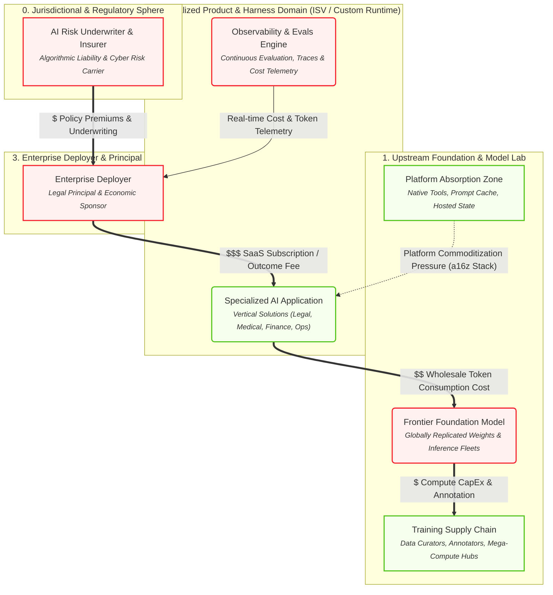

# Executive & Economic Perspective

> Capital allocation, SaaS margins, token cost exposure, and platform absorption (a16z & Sequoia Stack).

## Architecture Diagram

## Active Elements in this Lens

| Element | Cluster | Operational Role & Properties |
| :--- | :--- | :--- |
| **AI Risk Underwriter & Insurer** <small>Algorithmic Liability & Cyber Risk Carrier</small> `N_INSURER` | 0. Jurisdictional & Regulatory Sphere | **cardinality**: 10^2 Global Underwriters **underwriting_gate**: Requires verifiable audit trail & human oversight **vsm_tier**: System 3 (Economic Viability Gate) **nist_function**: MANAGE |
| **Training Supply Chain** <small>Data Curators, Annotators, Mega-Compute Hubs</small> `N_TRAIN` | 1. Upstream Foundation & Model Lab | **cardinality**: Top 5-10 Global Mega-Campuses **compute_profile**: Concentrated 50k-100k+ GPU clusters; GW-scale power **cost_type**: Fixed / Heavy CapEx ($600B Infrastructure Question) **ip_risk**: Copyright infringement / scraping litigation **vsm_tier**: System 1 (Upstream Production) **nist_function**: MAP |
| **Frontier Foundation Model** <small>Globally Replicated Weights & Inference Fleets</small> `N_FRONTIER` | 1. Upstream Foundation & Model Lab | **cardinality**: Top 5-10 Labs; Replicated across 10^3 Regional Clusters **compute_profile**: High memory-bandwidth inference clusters; low latency **sovereignty_gap**: Physical data residency does not equal jurisdictional independence **eu_ai_act_role**: Provider_GPAI **pricing_model**: Wholesale Per-Token Usage **liability_posture**: Disclaimed via ToS ('AS-IS') **vsm_tier**: System 4 (Probabilistic Intelligence Engine) **nist_function**: MEASURE |
| **Platform Absorption Zone** <small>Native Tools, Prompt Cache, Hosted State</small> `N_ABSORBED` | 1. Upstream Foundation & Model Lab | **cardinality**: Top 3-5 Cloud Ecosystems **market_effect**: Feature commoditization of wrapper ISVs (a16z Stack) **vsm_tier**: System 4 (Environmental Encroachment) |
| **Specialized AI Application** <small>Vertical Solutions (Legal, Medical, Finance, Ops)</small> `N_ISV_PRODUCT` | 2. Specialized Product & Harness Domain (ISV / Custom Runtime) | **cardinality**: 10^4 - 10^5 Vertical SaaS Products **eu_ai_act_role**: Provider_System **pricing_model**: Per-Seat SaaS / Value-Added Outcome Fee **margin_exposure**: Squeezed between token costs & platform absorption **vsm_tier**: System 4 (Operational Domain Intelligence) **nist_function**: MAP |
| **Observability & Evals Engine** <small>Continuous Evaluation, Traces & Cost Telemetry</small> `N_OBSERVE` | 2. Specialized Product & Harness Domain (ISV / Custom Runtime) | **cardinality**: 10^4 Monitoring Pipelines **capabilities**: LLM-as-a-judge, OTEL tracing, token telemetry **vsm_tier**: System 3 (Performance Monitoring & Homeostasis) **nist_function**: MEASURE |
| **Enterprise Deployer** <small>Legal Principal & Economic Sponsor</small> `N_ENTERPRISE` | 3. Enterprise Deployer & Principal Domain | **cardinality**: 10^5 Commercial Deployers Globally **eu_ai_act_role**: Deployer **liability_posture**: Holds Vicarious & Strict Legal Liability **roi_hurdle**: High CapEx Recovery Pressure (Sequoia Act Two) **vsm_tier**: System 5 (Corporate Policy & Ultimate Governance) **nist_function**: GOVERN |

## Active Relationships & Protocols

| Source | Relationship / Protocol | Target | Type |
| :--- | :---: | :--- | :--- |
| **Enterprise Deployer** | $$$ SaaS Subscription / Outcome Fee | **Specialized AI Application** | `money` |
| **Specialized AI Application** | $$ Wholesale Token Consumption Cost | **Frontier Foundation Model** | `money` |
| **Frontier Foundation Model** | $ Compute CapEx & Annotation | **Training Supply Chain** | `money` |
| **Platform Absorption Zone** | Platform Commoditization Pressure (a16z Stack) | **Specialized AI Application** | `tension` |
| **AI Risk Underwriter & Insurer** | $ Policy Premiums & Underwriting | **Enterprise Deployer** | `money` |
| **Observability & Evals Engine** | Real-time Cost & Token Telemetry | **Enterprise Deployer** | `flow` |