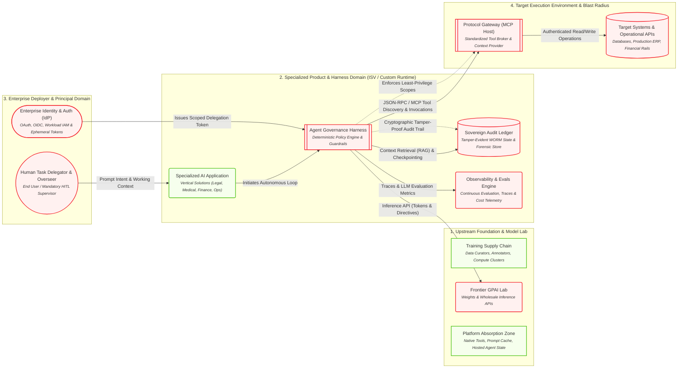

# Engineering & Technical Runtime Perspective

> The agentic execution loop: IdP delegation, inference protocols, MCP gateways, and state stores.

## Architecture Diagram

## Active Elements in this Lens

| Element | Cluster | Operational Role & Properties |
| :--- | :--- | :--- |
| **Training Supply Chain** <small>Data Curators, Annotators, Compute Clusters</small> `N_TRAIN` | 1. Upstream Foundation & Model Lab | **cost_type**: Fixed / Heavy R&D CapEx **ip_risk**: Copyright / Scraping litigation |
| **Frontier GPAI Lab** <small>Weights & Wholesale Inference APIs</small> `N_FRONTIER` | 1. Upstream Foundation & Model Lab | **eu_ai_act_role**: Provider_GPAI **pricing_model**: Per-Token Usage **liability_posture**: Disclaimed via ToS ('AS-IS') |
| **Platform Absorption Zone** <small>Native Tools, Prompt Cache, Hosted Agent State</small> `N_ABSORBED` | 1. Upstream Foundation & Model Lab | **market_effect**: Feature commoditization of wrapper ISVs |
| **Specialized AI Application** <small>Vertical Solutions (Legal, Medical, Finance, Ops)</small> `N_ISV_PRODUCT` | 2. Specialized Product & Harness Domain (ISV / Custom Runtime) | **eu_ai_act_role**: Provider_System **pricing_model**: SaaS Seat / Value Outcome |
| **Agent Governance Harness** <small>Deterministic Policy Engine & Guardrails</small> `N_HARNESS` | 2. Specialized Product & Harness Domain (ISV / Custom Runtime) | **iso_42001_role**: AIMS Technical Control Implementation **duty_of_care**: Caps blast radius, halts unsafe prompts/actions |
| **Sovereign Audit Ledger** <small>Tamper-Evident WORM State & Forensic Store</small> `N_AUDIT_STORE` | 2. Specialized Product & Harness Domain (ISV / Custom Runtime) | **compliance**: Art. 12 Mandatory Logging / Rebuttal of Fault **sovereignty**: Client / Enterprise Owned |
| **Observability & Evals Engine** <small>Continuous Evaluation, Traces & Cost Telemetry</small> `N_OBSERVE` | 2. Specialized Product & Harness Domain (ISV / Custom Runtime) | **capabilities**: LLM-as-a-judge, OTEL tracing, token cost tracking |
| **Enterprise Identity & Auth (IdP)** <small>OAuth, OIDC, Workload IAM & Ephemeral Tokens</small> `N_IDP` | 3. Enterprise Deployer & Principal Domain | **security_role**: Issues scoped actor delegations to agents |
| **Human Task Delegator & Overseer** <small>End User / Mandatory HITL Supervisor</small> `N_HUMAN_USER` | 3. Enterprise Deployer & Principal Domain | **control_mode**: Prompting, Art. 14 Human Oversight, Override |
| **Protocol Gateway (MCP Host)** <small>Standardized Tool Broker & Context Provider</small> `N_MCP_HOST` | 4. Target Execution Environment & Blast Radius | **protocol_standard**: Model Context Protocol (MCP) **isolation**: Dynamic capability & permission negotiation |
| **Target Systems & Operational APIs** <small>Databases, Production ERP, Financial Rails</small> `N_TARGET_SYS` | 4. Target Execution Environment & Blast Radius | **risk_zone**: Direct Causation Blast Radius |

## Active Relationships & Protocols

| Source | Relationship / Protocol | Target | Type |
| :--- | :---: | :--- | :--- |
| **Agent Governance Harness** | Cryptographic Tamper-Proof Audit Trail | **Sovereign Audit Ledger** | `governance_control` |
| **Agent Governance Harness** | Enforces Least-Privilege Scopes | **Protocol Gateway (MCP Host)** | `governance_control` |
| **Human Task Delegator & Overseer** | Prompt Intent & Working Context | **Specialized AI Application** | `flow` |
| **Enterprise Identity & Auth (IdP)** | Issues Scoped Delegation Token | **Agent Governance Harness** | `protocol` |
| **Specialized AI Application** | Initiates Autonomous Loop | **Agent Governance Harness** | `flow` |
| **Agent Governance Harness** | Inference API (Tokens & Directives) | **Frontier GPAI Lab** | `protocol` |
| **Agent Governance Harness** | Context Retrieval (RAG) & Checkpointing | **Sovereign Audit Ledger** | `flow` |
| **Agent Governance Harness** | Traces & LLM Evaluation Metrics | **Observability & Evals Engine** | `flow` |
| **Agent Governance Harness** | JSON-RPC / MCP Tool Discovery & Invocations | **Protocol Gateway (MCP Host)** | `protocol` |
| **Protocol Gateway (MCP Host)** | Authenticated Read/Write Operations | **Target Systems & Operational APIs** | `flow` |