import useBaseUrl from '@docusaurus/useBaseUrl';

## AI Ecosystem: Multi-Lens Architecture & Governance

### Welcome to Sezoo's **AI Ecosystem Model**

This is an interactive model designed to help decision-makers, architects, and regulators explore and make sense of the global AI ecosystem. 

Most analyses view AI through a single, isolated lens: engineers focus on model weights and APIs; economists analyze CapEx and subscription margins; lawyers debate liability regimes; and safety researchers evaluate model alignment. In reality, these domains are connected by explicit and implicit relationships. There is no hierarchy in these relationships - no view is "superior" to the other, but there are side-effects and consequences. Pulling one thread can affect many others, and sometimes with unexpected consequences. 

Our goal with this model is to balance **sufficient conceptual richness with sufficient visual simplicity**. Providing a map rigorous enough to stress-test real-world decisions, yet clear enough to build shared understanding. Two favourite quotes/sayings have been front of mind during the development:

> *"All models are wrong, but some are useful."* — George Box

> *"A model is only useful because it **simplifies** reality"* - Borges' Map

One glaring omission is that we have not (yet) included a philosophical dimension to the model. There are no perspectives in the model on what intelligence actually is, where it might be in an AI ecosystem if it DOES exist, and whether that actually matters when things that lack intelligence can be still be useful and dangerous. Anyhow, we haven't included this, yet. Sorry.

---

### Modeling Reality, Warts and All (Descriptive, Not Prescriptive)

A common flaw in governance modeling is to design an idealized world where every control works and every loop closes cleanly. This model takes the opposite approach: **it maps empirical reality, warts and all.** This is made clear in the way that we consider the results of inqueries on the model. When exploring inquiries, the findings fall into three categories:

* **The System Works (Type 1):** The model traces how existing statutory, economic, or technical mechanisms function. We can explain some phenomena with the model.
* **The Model Has a Gap (Type 2):** Reality has a working practice that our model hasn't captured yet (which we actively patch via community issues).
* **Reality Has a Gap (Type 3):** The model reveals a severed recourse chain, an unverified credential, or an insurmountable chokepoint **because reality is currently broken**.

Inquiries that highlight a real-world gap are our most valuable outputs—they point directly to where liability is unassigned, where safety checks are superficial, or where market captivity exists. We'd rather help improve AI understanding and AI, than improve our model. The model needs to be good enough to be useful.

### The Theoretical Foundations

The model uses four frameworks to create a single, machine readable property graph:

#### 1. Cybernetic Control: Stafford Beer’s Viable System Model (VSM)
Traditional governance models rely on static organizational charts. In contrast, Beer’s VSM[^1] assesses whether a system possesses the operational variety and regulatory feedback required to remain **viable** under dynamic (changing) conditions. The model divides an organization into two main halves: System 1 (\"S1\", Operations), which does the primary work, and Systems 2–5 (\"S2-5\", the Meta-System), which coordinate, control, plan, and govern the whole enterprise. Two other key concepts are *recursion*: a viable system is considered a fractal; and *algedonic signals*: emergency alert channels.  

* **Viewpoint-Relative Recursion:** VSM roles are not defined by node tags. An entity's role depends on the chosen system-in-focus. We model two primary recursion levels:
  * **Level 0 (Enterprise AI Operations):** How an enterprise balances autonomous agent operations (*S1*) through coordination (*S2*), policy kernels and audit stores (*S3*), risk intelligence (*S4*), and executive direction (*S5*).
  * **Level +1 (Societal & Jurisdictional Governance):** How global markets (*S1*), standards bodies (*S2*), regulators and courts (*S3*), safety institutes (*S4*), and legislature (*S5*) maintain macro-societal viability.
* **The Algedonic Channel:** A dedicated emergency tripwire that bypasses intermediate bureaucratic layers (*S3*) directly to ultimate policy closure (*S5*) when critical failures or systemic harms occur.

#### 2. Value Chains & Capital Constraints: Simon Wardley’s Evolution Mapping
Components in the AI stack do not share the same economic properties. We are trying to map the evolution of value-chain components using a Wardley Maps[^2] scale from from **Genesis → Custom-Built → Product → Commodity**:
* **Physical & Capital Chokepoints:** Photolithography equipment (ASML EUV) and leading-edge semiconductor packaging (TSMC CoWoS) remain rare, highly centralized capital assets with multi-year construction lead times and *prohibitive* switching costs.
* **Artificial Lock-In on Utilities:** Cloud compute and raw storage are commodity utilities, yet hyperscalers construct artificial switching costs through egress fees, proprietary IAM meshes, and bundled foundation models.

**Note:** There is significant scope to further develop the use of the Wardley Map evaluation in the model, but we think this is best done as a worked use-case exercise. At present we have ensured that the model *can* represent Wardley Map maturity. 

#### 3. Non-Linear Feedback Dynamics (Jay Forrester & Donella Meadows)
Donella Meadows added value to Jay Forrester's earlier work[^3] and their work encouraged us to include the observation that the AI ecosystem includes non-linear delays and feedback loops. For example:
* **Reinforcing Flywheels (*R1*):** Capital markets subsidize training compute, producing frontier capability and valuation uplift, which in turn attracts more capital, driving extreme market concentration.
* **Balancing Brakes (*B1*–*B4*):** Open-weight model releases compress commercial inference margins (*B1*), while real-world blast radius harms trigger regulatory penalties, social-licence revocation, and legislative intervention (*B2*–*B4*).

#### 4. Computable Schema & Referential Integrity (LinkML)
Early iterations of this model used a stand-alone data model instance "loosely" defined in YAML. As we evolved our thinking we abstracted the schema from the model instance and introduced a more formal (LinkML) structure for the schema (expressed using YAML). 

The current model is built on a structured blueprint (`ai_ecosystem_schema.yaml`). Before any diagrams or web pages are created, every component, connection, system complexity level, and legal requirement is automatically checked against strict rules to make sure it fits together properly.

---

## Exploring the Model

### Interactive Ecosystem Explorer

Use the interactive viewer below to explore the global model. You can switch between thematic views, isolate specific domains (Economic, Governance, Technical), run standing inquiries, or click any node to inspect its cardinality, Ashby variety, and VSM roles:

  <iframe
    src="/viewer/?view=all" 
    width="100%" 
    height="100%" 
    style={{ border: '1px solid #282d3c', borderRadius: '8px', backgroundColor: '#14161d' }} 
    title="AI Ecosystem Interactive Model Viewer"
  ></iframe>

*(Tip: You can also toggle the **Matrix** tab in the viewer toolbar to inspect cluster connectivity and gap analysis).*

You can see a whole page version of this here: https://ai-ecosystem.sezoo.digital/viewer/

---

## How to Use the Model for Sense-Making

### 1. Review Pre-Computed Inquiries

Each inquiry in this section investigates a specific strategic question against the canonical model. 

When an inquiry reveals a broken path (e.g., no recourse upstream of an enterprise deployer, or missing token validation at an agent gateway), **that is the insight**. We do not smooth over real-world cracks to make the diagrams look complete. We have produced a number of outputs from analytical investigations into core strategic questions. These include:
* **[Physical & Geopolitical Chokepoints](./inquiries/inq-physical-geopolitical-chokepoints.md):** Where power concentrates and single points of failure reside.
* **[Macroeconomics & Valuations](./inquiries/inq-ai-economics-valuations.md):** How CapEx cycles, token deflation, and open-weight commoditization interact.
* **[Public Trust & Liability](./inquiries/inq-public-trust-and-social-acceptance.md):** Where recourse breaks when autonomous systems cause downstream harm.
* **[Standards & Certification](./inquiries/inq-standards-certification-efficiency.md):** How voluntary standards attenuate technical variety into compliance baselines.
* **[Continuing Assurance](./inquiries/inq-continuing-assurance.md):** How approvals remain trustworthy as systems drift and how permissions are revoked.

Visit the **[Sense-Making Inquiries](./inquiries)** section to explore the library.

### 2. Formulate a New Line of Inquiry
You can use the model to evaluate novel policy questions, architectural changes, or strategic investments using an LLM-assisted workflow:

1. **Select an LLM Environment:** Open your environment of choice (e.g. Claude, Google AI Studio, ChatGPT).
2. **Load the Protocol:** Provide the system instructions from `prompts/inquiry_protocol.md`.
3. **Provide Context:** Attach the canonical model file `model/ai_ecosystem.yaml` (if your interface has trouble with file attachments, paste the YAML content enclosed in triple backticks).
4. **Explore Conversationally:** Interrogate the graph (e.g., *"What happens to systemic viability if independent safety institutes are removed?"* or *"How does token deflation affect ISV application margins?"*).
5. **Draft & Contribute:** Prompt the AI to *"Draft the inquiry artifact following the Sezoo inquiry template"*, verify the referential integrity using `validate_ecosystem.py --refs`, and submit a Pull Request to our GitHub repository.

**Remember:** We expect that some inquiries will identify gaps and / or opportunities to improve the model. Suggestions on model improvement supported by justifications and explanations are welcome. 

---

## Canonical Model Sources & Visual Exports

The complete, computable representation is maintained in our open repository:
* **Metamodel Schema:** [`schema/ai_ecosystem_schema.yaml`](https://raw.githubusercontent.com/sezoo-digital/ai-ecosystem-model/refs/heads/main/schema/ai_ecosystem_schema.yaml)
* **Model Instance:** [`model/ai_ecosystem.yaml`](https://raw.githubusercontent.com/sezoo-digital/ai-ecosystem-model/refs/heads/main/model/ai_ecosystem.yaml)

Below, the master architecture is documented via static visual keys, feedback loops, VSM frame assignments, and the complete element dictionary.

[^1]: There are many sources and books on VSM, this is the wikipedia entry: https://en.wikipedia.org/wiki/Viable_system_model 

[^2]: There are many places to learn about Simon Wadley Maps, here's one: https://www.wardleymaps.com/guides/wardley-mapping-101

[^3]: Meadows, D. H. (2008). Thinking in systems: A primer (D. Wright, Ed.). Chelsea Green Publishing.

:::tip Download Canonical Models
Download the raw model to query in external visual modeling tools:

- <a href={useBaseUrl("/exports/ai_ecosystem.graphml")} download="ai_ecosystem.graphml">**Download for yEd** (.graphml)</a>
- <a href={useBaseUrl("/exports/ai_ecosystem.drawio")} download="ai_ecosystem.drawio">**Download for draw.io** (.drawio)</a>
- <a href={useBaseUrl("/exports/ai_ecosystem_kumu.json")} download="ai_ecosystem_kumu.json">**Download for Kumu Blueprint** (.json)</a>
:::

```mermaid
flowchart LR
    classDef gov fill:#FFF1F0,stroke:#F5222D,stroke-width:2px;
    classDef econ fill:#F6FFED,stroke:#52C41A,stroke-width:2px;
    classDef tech fill:#E6F7FF,stroke:#1890FF,stroke-width:2px;
    classDef default fill:#F8FAFC,stroke:#64748B,stroke-width:1.5px;

    subgraph LegendShapes ["Architectural Node Archetypes"]
        K_STA{{"Statutory Authority<br/><small><i>kind: statutory_authority</i></small>"}}:::gov
        K_PUB{{"Public Authority (AISI)<br/><small><i>kind: public_authority</i></small>"}}:::gov
        K_PRV(["Private Oversight Body<br/><small><i>kind: private_oversight_body</i></small>"]):::gov
        K_ORG["Organisation<br/><small><i>kind: organisation</i></small>"]:::econ
        K_PER(("Person<br/><small><i>kind: person</i></small>")):::gov
        K_THR{{"Threat Actor<br/><small><i>kind: threat_actor</i></small>"}}:::gov
        K_SWS("Software Service<br/><small><i>kind: software_service</i></small>"):::tech
        K_CTR[["Control Component<br/><small><i>kind: control_component</i></small>"]]:::tech
        K_STO[("Data Store<br/><small><i>kind: data_store</i></small>")]:::tech
        K_COM(["Commons<br/><small><i>kind: commons</i></small>"]):::tech
    end
```

<strong>📖 Visual Language & Architectural Key (Click to expand)</strong>

### Node Archetypes (Kinds)

| Kind | Semantic Meaning | Visual Shape |
| :--- | :--- | :---: |
| `statutory_authority` | Legal authorities, enforcement agencies, courts, market surveillance | `hexagon` |
| `public_authority` | Non-statutory public bodies: national AI safety institutes, horizon evaluators | `hexagon` |
| `private_oversight_body` | Standards bodies, accredited certification and audit bodies (ISO/CEN) | `stadium` |
| `organisation` | Commercial firms, labs, cloud platforms, deployers, insurers, capital funds | `rect` |
| `person` | Natural persons or populations (delegators, overseers, citizens, consumers) | `circle` |
| `threat_actor` | Hostile adversaries (prompt injectors, jailbreakers, model poisoners) | `hexagon` |
| `software_service` | Models, vertical applications, agent runtimes, observability engines | `rounded` |
| `control_component` | Deterministic gates, policy kernels, identity brokers, tool gateways | `subproc` |
| `data_store` | Vector knowledge bases, sovereign audit ledgers, production ERP systems | `cylinder` |
| `commons` | Open-weight model weights, open-source codebases, shared artifacts | `stadium` |

### Relationship & Edge Types

| Line Style | Semantic Relation Kind | Description |
| :---: | :--- | :--- |
| `== '🚨 label' ==>` | `algedonic_signal` | **VSM Emergency Tripwire:** Direct crisis bypass from S1 operations to S5 board/policy |
| `== 'label' ==>` | `commercial_flow` | Capital investment, SaaS fees, wholesale token tolls, insurance premiums |
| `== 'label' ==>` | `resource_supply` | Hardware allocation, compute capacity delivery, training data corpus |
| `== 'label' ==>` | `statutory_mandate` | Statutory orders, compliance mandates, export control sanctions |
| `-. 'label' .->` | `governance_control` | Policy bounds, audit trail logging, S3* independent sampling probes |
| `-. 'label' .->` | `liability_exposure` | Real-world tort liability, blast radius causation, direct civil exposure |
| `-. 'label' .->` | `competitive_pressure` | Market margin compression, platform absorption, open-weight price deflation |
| `-. 'label' .->` | `physical_constraint` | Hard physical limits: power grid capacity, transformer delays, fab throughput |
| `-. '⚡ label' .->` | `adversarial_attack` | Hostile prompt injection, jailbreaking, data poisoning, credential theft |
| `-. 'label' .->` | `contractual_term` | Contractual liability carve-outs, ToS 'AS-IS' disclaimers |
| `-->|'label'|` | `protocol_call` | Technical protocols (A2E, MIP, A2T via MCP, A2A) |
| `-->|'label'|` | `data_flow` | Telemetry traces, prompt context (RAG), model weights, evidence logs |

### Market Dynamics: Wardley Stages, Power Asymmetry & Switching Costs

| Property | Values | Semantic Meaning |
| :--- | :--- | :--- |
| **`evolution_stage`** | `genesis` | Novel, experimental, unproven concepts with high uncertainty |
| | `custom_built` | Bespoke, differentiated implementations or rare capital assets (e.g. ASML lithography) |
| | `product` | Standardized, commercially packaged software or hardware products |
| | `commodity` | Ubiquitous utility or open commons (zero-marginal cost) |
| **`power_asymmetry`** | `supplier_dominant` | Supplier dictates pricing, access, and terms (seller's market) |
| | `buyer_dominant` | Buyer dictates terms and performance specifications (buyer's market) |
| | `balanced` | Bilateral commercial parity |
| | `captive` | Downstream participant is structurally trapped with near-zero alternative options |
| **`switching_cost`** | `prohibitive` | Switching requires full architectural, physical, or legal refactoring |
| | `high` | Switching requires extensive re-indexing, prompt re-tuning, and workflow rebuilding |
| | `moderate` | Standard multi-cloud or modular API adaptation effort |
| | `low` | Commoditized, drop-in replacement (e.g. OpenAI-compatible open-weight endpoints) |

## Unified Ecosystem Architecture
The diagram below is generated from the full model instance using the `ai_ecosystem.yaml` file content and mermaid to render the diagram.

```mermaid
flowchart TB
    classDef gov fill:#FFF1F0,stroke:#F5222D,stroke-width:2px;
    classDef econ fill:#F6FFED,stroke:#52C41A,stroke-width:2px;
    classDef tech fill:#E6F7FF,stroke:#1890FF,stroke-width:2px;
    classDef default fill:#F8FAFC,stroke:#64748B,stroke-width:1.5px;

    subgraph cluster_regulatory ["0. Jurisdictional, Capital & Regulatory Sphere"]
        N_REGULATOR{{"Statutory &amp; Trade Authorities<br/><small><i>EU AI Office &amp; national authorities, FTC/state AGs, BIS export controls, China CAC, UK &amp; APAC regulators</i></small>"}}:::gov
        N_STANDARDS_BODY(["Standards Setting Organisations<br/><small><i>ISO/IEC JTC 1/SC 42, NIST, CEN-CENELEC, IEEE</i></small>"]):::gov
        N_SAFETY_INSTITUTE{{"AI Safety &amp; Security Institutes<br/><small><i>US CAISI (formerly AISI), UK AI Security Institute, Japan AISI, frontier evaluators</i></small>"}}:::gov
        N_AUDITOR(["Conformity &amp; Certification Bodies<br/><small><i>EU notified bodies, ISO/IEC 42001 certifiers</i></small>"]):::gov
        N_INSURER["AI Risk Underwriter &amp; Insurer<br/><small><i>Algorithmic liability and cyber risk carriers</i></small>"]:::gov
        N_CAPITAL["Capital Markets &amp; Venture Underwriters<br/><small><i>VC syndicates, hyperscaler equity, sovereign wealth</i></small>"]:::econ
        N_LEGISLATURE{{"Legislatures &amp; Executive Policy-Makers<br/><small><i>EU Parliament &amp; Council, US Congress &amp; executive, national parliaments, ministries</i></small>"}}:::gov
        N_COURTS{{"Courts &amp; Dispute Resolution<br/><small><i>National and EU courts, arbitration, class-action mechanisms</i></small>"}}:::gov
        N_CIVIL_SOCIETY["Civil Society, Researchers &amp; Media<br/><small><i>NGOs, journalists, academic researchers, incident databases, advocacy groups</i></small>"]:::gov
    end

    subgraph cluster_supply ["1. Upstream Silicon, Energy, Cloud, Data & Model Supply"]
        N_SILICON["Leading-Edge Silicon &amp; Lithography<br/><small><i>ASML (EUV), TSMC (foundry), Nvidia, HBM memory</i></small>"]:::econ
        N_ENERGY_GRID["Energy Grids &amp; Power Generation<br/><small><i>Nuclear PPAs, substation transformers, cooling</i></small>"]:::econ
        N_TRAIN["Training Compute Campuses<br/><small><i>Mega data centers, GW-scale cluster fabric, power substations</i></small>"]:::econ
        N_CLOUD_HYPERSCALER["Hyperscaler Cloud Platform<br/><small><i>Azure, AWS, Google Cloud, OCI</i></small>"]:::econ
        N_DATA_RIGHTS["Training Data &amp; Rights Holders<br/><small><i>Publishers, creators, data brokers, annotation vendors, licensing collectives</i></small>"]:::gov
        N_FRONTIER_LAB["Frontier AI Labs<br/><small><i>Organisations that train and release frontier models</i></small>"]:::gov
        N_FRONTIER_MODEL("Frontier Foundation Model<br/><small><i>Globally replicated weights and inference fleets</i></small>"):::econ
        N_OPEN_MODEL(["Open-Weight Model Commons<br/><small><i>Commoditised weights, distilled checkpoints, local runtimes</i></small>"]):::econ
    end

    subgraph cluster_product ["2. Application & Agent Domain"]
        N_ISV_PRODUCT("AI Applications<br/><small><i>Vertical enterprise solutions (legal, medical, finance, ops) and consumer apps</i></small>"):::econ
        N_AGENT("Agent Runtime<br/><small><i>Plan-act loop: reasoning, tool use, working and episodic state</i></small>"):::tech
        N_GUARDRAIL[["Policy &amp; Guardrail Kernel<br/><small><i>Least privilege, pre-execution authorisation, kill switch, scope limits</i></small>"]]:::gov
        N_AUDIT_STORE[("Sovereign Audit Ledger<br/><small><i>Tamper-evident WORM state and forensic store</i></small>")]:::gov
        N_OBSERVE("Observability &amp; Evals Engine<br/><small><i>Continuous evaluation, traces, cost telemetry</i></small>"):::gov
    end

    subgraph cluster_client ["3. Enterprise Deployer & Principal Domain"]
        N_ENTERPRISE["Enterprise Deployer<br/><small><i>Legal principal and economic sponsor</i></small>"]:::gov
        N_AI_GOVERNANCE["Enterprise AI Governance Function<br/><small><i>AI risk committee, management-system owner, horizon scanning</i></small>"]:::gov
        N_IDP[["Enterprise Identity &amp; Auth (IdP)<br/><small><i>OAuth, OIDC, workload IAM, ephemeral tokens</i></small>"]]:::gov
        N_KNOWLEDGE_STORE[("Enterprise Semantic Knowledge Base<br/><small><i>Proprietary vector DBs, documents, embeddings</i></small>")]:::tech
        N_HUMAN_USER(("Human Task Delegator &amp; Overseer<br/><small><i>End user and mandatory human-in-the-loop supervisor</i></small>")):::gov
    end

    subgraph cluster_environment ["4. Execution Environment, Blast Radius & Adversaries"]
        N_TOOL_GATEWAY[["Capability &amp; Tool Gateway<br/><small><i>Decoupled tool broker and context provider (MCP)</i></small>"]]:::gov
        N_TARGET_SYS[("Target Systems &amp; Operational APIs<br/><small><i>Databases, production ERP, financial rails</i></small>")]:::gov
        N_AFFECTED_PARTY(("Affected Individuals &amp; Consumers<br/><small><i>Consumers, employees, citizens</i></small>")):::gov
        N_THREAT_ACTOR{{"Adversaries &amp; Misuse Actors<br/><small><i>Cybercriminals, state actors, prompt-injection attackers, malicious tool publishers</i></small>"}}:::gov
    end

    N_CAPITAL == "$$$ Fab capex & lithography tool procurement" ==> N_SILICON
    N_CAPITAL == "$$$ Clean-energy PPAs & grid upgrades" ==> N_ENERGY_GRID
    N_REGULATOR == "Export controls, entity listings & technology sanctions" ==> N_SILICON
    N_SILICON == "Leading-edge GPU allocation & advanced packaging (CoWoS)" ==> N_TRAIN
    N_ENERGY_GRID -. "Physical GW power & transformer bottleneck" .-> N_TRAIN
    N_CAPITAL == "$$$ Equity subsidies & compute credits" ==> N_FRONTIER_LAB
    N_CAPITAL == "$$$ Campus project debt & equity" ==> N_TRAIN
    N_FRONTIER_LAB == "$ Compute commitments & offtake contracts" ==> N_TRAIN
    N_TRAIN == "Training & inference compute capacity" ==> N_FRONTIER_LAB
    N_TRAIN == "Cluster hosting & bare-metal capacity resold via cloud" ==> N_CLOUD_HYPERSCALER
    N_CLOUD_HYPERSCALER == "Hyperscale inference fleet hosting & orchestration" ==> N_FRONTIER_MODEL
    N_FRONTIER_LAB -. "Trains, gates and releases the model" .-> N_FRONTIER_MODEL
    N_FRONTIER_LAB -->|"Open-weight release of sunk-cost models"| N_OPEN_MODEL
    N_OPEN_MODEL -. "Inference price deflation & compression" .-> N_FRONTIER_LAB
    N_DATA_RIGHTS == "Training corpus, licensed content & annotation labour" ==> N_FRONTIER_LAB
    N_DATA_RIGHTS -. "Copyright, licensing & data-protection claims" .-> N_FRONTIER_LAB
    N_FRONTIER_LAB == "Valuation uplift & investor returns" ==> N_CAPITAL
    N_ENTERPRISE == "$$$ SaaS subscription / outcome fee" ==> N_ISV_PRODUCT
    N_ISV_PRODUCT == "$$ Wholesale token consumption cost" ==> N_FRONTIER_LAB
    N_ENTERPRISE == "$$$ Cloud spend commitments & enterprise tenancy" ==> N_CLOUD_HYPERSCALER
    N_ENTERPRISE == "$ Policy premiums & risk transfer" ==> N_INSURER
    N_FRONTIER_LAB -. "Native tools, prompt cache & hosted state absorb wrapper value" .-> N_ISV_PRODUCT
    N_CLOUD_HYPERSCALER -. "Platform-native AI services commoditise vertical features" .-> N_ISV_PRODUCT
    N_ISV_PRODUCT -->|"Self-hosted / private inference (zero token toll)"| N_OPEN_MODEL
    N_AFFECTED_PARTY == "Direct consumer subscriptions & usage" ==> N_ISV_PRODUCT
    N_ISV_PRODUCT -->|"Direct-to-consumer AI interaction"| N_AFFECTED_PARTY
    N_AFFECTED_PARTY -. "Market resistance, churn & social-licence revocation" .-> N_ENTERPRISE
    N_SAFETY_INSTITUTE -->|"Evaluations & systemic-risk alerts (S4 to S3)"| N_REGULATOR
    N_STANDARDS_BODY -. "Harmonised standards & audit specifications" .-> N_AUDITOR
    N_STANDARDS_BODY -. "Technical control standards & interoperability profiles" .-> N_GUARDRAIL
    N_FRONTIER_LAB -->|"Pre-release model access for red-teaming"| N_SAFETY_INSTITUTE
    N_REGULATOR == "Statutory penalties & enforcement" ==> N_ENTERPRISE
    N_REGULATOR == "GPAI codes of practice & transparency duties" ==> N_FRONTIER_LAB
    N_REGULATOR == "High-risk system compliance & surveillance" ==> N_ISV_PRODUCT
    N_AUDITOR -. "Conformity audits & certification" .-> N_ENTERPRISE
    N_FRONTIER_LAB -. "Disclaims liability (ToS as-is / recourse gap)" .-> N_ENTERPRISE
    N_ENTERPRISE -. "Vicarious liability for harm (respondeat superior)" .-> N_AFFECTED_PARTY
    N_AFFECTED_PARTY -->|"Complaints & redress demands (Art. 85)"| N_REGULATOR
    N_INSURER -. "Underwriting gate: audit trail & human oversight required" .-> N_ENTERPRISE
    N_ENTERPRISE -. "Mandate & resourcing of AI governance" .-> N_AI_GOVERNANCE
    N_ENTERPRISE -. "Delegates authority & safety boundaries (S5 to S3)" .-> N_GUARDRAIL
    N_AI_GOVERNANCE -. "Policy refinement from horizon scanning (S4 to S3)" .-> N_GUARDRAIL
    N_HUMAN_USER -. "Art. 14 human oversight & kill switch" .-> N_AGENT
    N_GUARDRAIL -. "Policy envelope & runtime constraints (S3 to S1)" .-> N_AGENT
    N_AGENT -->|"Action proposals for pre-execution authorisation"| N_GUARDRAIL
    N_GUARDRAIL -->|"Tamper-evident decision & action trail (Art. 12)"| N_AUDIT_STORE
    N_AUDIT_STORE -->|"Forensic evidence for compliance verification"| N_AUDITOR
    N_GUARDRAIL -. "Enforces least-privilege scopes (S3 to S2)" .-> N_TOOL_GATEWAY
    N_TARGET_SYS -->|"Direct impact & real-world blast radius"| N_AFFECTED_PARTY
    N_LEGISLATURE == "Statutory mandates, powers & funding (S5 to S3)" ==> N_REGULATOR
    N_SAFETY_INSTITUTE -->|"Capability and risk assessments informing policy (S4 to S5)"| N_LEGISLATURE
    N_STANDARDS_BODY -. "Harmonised standards & presumption-of-conformity pathway" .-> N_ISV_PRODUCT
    N_AFFECTED_PARTY -. "Tort, statutory & class claims" .-> N_COURTS
    N_COURTS == "Adjudicates liability & orders redress" ==> N_ENTERPRISE
    N_AFFECTED_PARTY -->|"Reports harm to advocates, researchers & media"| N_CIVIL_SOCIETY
    N_CIVIL_SOCIETY == "🚨 Public alarm: investigations, advocacy & media pressure bypassing regulators" ==> N_LEGISLATURE
    N_AI_GOVERNANCE -->|"Risk assessments & policy recommendations (S4 to S5)"| N_ENTERPRISE
    N_FRONTIER_LAB -->|"Mandatory rapid incident notifications (Art. 55 GPAI systemic risk)"| N_REGULATOR
    N_REGULATOR == "Recognition, supervision & suspension of conformity bodies; can require reassessment after incidents" ==> N_AUDITOR
    N_OBSERVE -->|"Behavioural evaluation evidence for continuing surveillance (enterprise-operated)"| N_AUDITOR
    N_AUDITOR -->|"Certification status & scope as an underwriting basis (third-party reliance)"| N_INSURER
    N_ENTERPRISE -. "Grants, scopes & revokes delegated authority (S5 to S2)" .-> N_IDP
    N_IDP -->|"Credential validation at call time: withdrawn authority stops tool access"| N_TOOL_GATEWAY
    N_OBSERVE -. "S3* independent behavioural probe & red-teaming" .-> N_TARGET_SYS
    N_TARGET_SYS == "🚨 Algedonic alarm: direct S1 to S5 circuit breaker" ==> N_ENTERPRISE
    N_THREAT_ACTOR -. "⚡ Prompt injection, tool poisoning, credential abuse" .-> N_AGENT
    N_THREAT_ACTOR -. "⚡ Jailbreaks & capability misuse" .-> N_FRONTIER_MODEL
    N_HUMAN_USER -->|"Prompt intent & working context"| N_ISV_PRODUCT
    N_IDP -->|"A2E workload identity delegation (OAuth/OIDC)"| N_AGENT
    N_ISV_PRODUCT -->|"Initiates autonomous loop"| N_AGENT
    N_AGENT -->|"MIP inference API (tokens & directives)"| N_FRONTIER_MODEL
    N_AGENT -->|"RAG semantic retrieval & working context (CoALA)"| N_KNOWLEDGE_STORE
    N_AGENT -->|"A2A multi-agent delegation & peer protocol"| N_AGENT
    N_AGENT -->|"Traces & LLM evaluation metrics"| N_OBSERVE
    N_OBSERVE -->|"Real-time cost & token telemetry"| N_ENTERPRISE
    N_OBSERVE -->|"Evaluation results & incident telemetry"| N_AI_GOVERNANCE
    N_AGENT -->|"A2T tool calling & context protocol (MCP / OpenAPI)"| N_TOOL_GATEWAY
    N_TOOL_GATEWAY -->|"Authenticated operations execution"| N_TARGET_SYS
    N_AGENT -->|"Self-hosted / private open inference (MIP)"| N_OPEN_MODEL
```

## 1. Named Cybernetic Feedback Loops

The model formalizes feedback loops with explicit state variables and mathematical polarity signs:

| Loop ID | Type | Name | Dynamic Description | Edge Pathway |
| :--- | :---: | :--- | :--- | :--- |
| `L_R1_CAPITAL_COMPUTE_FLYWHEEL` | **Reinforcing (R)** | **Capital-compute-valuation flywheel** | Capital funds lab compute commitments; compute yields capability and valuation uplift, which attracts more capital. Drives concentration. | `E_CAPITAL_TO_LAB` → `E_LAB_TO_TRAIN_CAPEX` → `E_TRAIN_TO_LAB_COMPUTE` → `E_LAB_TO_CAPITAL_RETURN` |
| `L_B1_OPEN_RELEASE_BRAKE` | *Balancing (B)* | **Open-release margin brake** | Labs that release open weights seed commodity inference, which compresses their own premium margins. | `E_LAB_TO_OPEN_RELEASE` → `E_OPEN_DEFLATION_LAB` |
| `L_B2_HARM_REGULATION` | *Balancing (B)* | **Harm-complaint-enforcement loop** | Harm triggers complaints and enforcement, the enterprise tightens guardrails, constraining agent actions on target systems. | `E_TARGET_HARM_AFFECTED` → `E_AFFECTED_TO_REG_COMPLAINT` → `E_REG_TO_ENT` → `E_ENT_TO_GUARDRAIL` → `E_GUARDRAIL_TO_AGENT` → `E_AGENT_TO_GATEWAY_A2T` → `E_GATEWAY_TO_TARGET` |
| `L_B3_SOCIAL_LICENCE` | *Balancing (B)* | **Social-licence loop** | Harm drives churn and reputational cost; the enterprise tightens guardrails without waiting for the regulator. | `E_TARGET_HARM_AFFECTED` → `E_AFFECTED_CHURN_ENT` → `E_ENT_TO_GUARDRAIL` → `E_GUARDRAIL_TO_AGENT` → `E_AGENT_TO_GATEWAY_A2T` → `E_GATEWAY_TO_TARGET` |
| `L_B4_HARM_ALARM_POLICY` | *Balancing (B)* | **Harm-alarm-policy loop** | Systemic harm reaches the legislature through the algedonic channel, widening mandates and enforcement. Slow, but it bypasses regulatory capture. | `E_TARGET_HARM_AFFECTED` → `E_AFFECTED_TO_CIVIL` → `E_CIVIL_TO_LEG_ALARM` → `E_LEG_TO_REG_MANDATE` → `E_REG_TO_ENT` → `E_ENT_TO_GUARDRAIL` → `E_GUARDRAIL_TO_AGENT` → `E_AGENT_TO_GATEWAY_A2T` → `E_GATEWAY_TO_TARGET` |

## 2. Viewpoint-Relative VSM Control Frames

In Beer's Viable System Model (VSM), Systems 1–5 are not intrinsic node tags; they are roles relative to a chosen system-in-focus at a given recursion level:

### Enterprise AI operations (recursion level 0) — `Recursion Level +0 (Enterprise)`

> One enterprise's AI-enabled operations. The knowledge store is a resource of S1 and is not given a role.

| VSM Role | Node | Architectural Rationale |
| :--- | :--- | :--- |
| `s1_operations` | `N_AGENT` | Performs the primary operational activity; stands for any number of S1 units, each recursively viable |
| `s1_operations` | `N_TARGET_SYS` | Operational substrate where activity lands; source of algedonic signals. Debatable: could be treated as environment |
| `s2_coordination` | `N_TOOL_GATEWAY` | Arbitrates tool and protocol access across agents |
| `s2_coordination` | `N_IDP` | Arbitrates identity and delegation across agents |
| `s3_control` | `N_GUARDRAIL` | Operational control, scope enforcement, accountability |
| `s3_control` | `N_AUDIT_STORE` | Accountability record for S3 |
| `s3_control` | `N_HUMAN_USER` | In its oversight capacity only: human override and supervision |
| `s3_star_audit` | `N_OBSERVE` | Independent probing outside the S3 command line |
| `s4_intelligence` | `N_AI_GOVERNANCE` | Scans models, vendors, regulation and incidents |
| `s5_policy` | `N_ENTERPRISE` | Legal principal; holds identity and ultimate policy |

### Global AI governance as a network of regimes (recursion level +1) — `Recursion Level +1 (Jurisdiction Meta-System)`

> Treated as one meta-system of interacting regimes (EU, US, China, UK, APAC). Per-regime frames are a possible extension.

| VSM Role | Node | Architectural Rationale |
| :--- | :--- | :--- |
| `s1_operations` | `N_ENTERPRISE` | Deploys AI-enabled economic activity |
| `s1_operations` | `N_ISV_PRODUCT` | Provides AI applications |
| `s1_operations` | `N_FRONTIER_LAB` | Produces frontier capability |
| `s1_operations` | `N_CLOUD_HYPERSCALER` | Provides platform capacity |
| `s2_coordination` | `N_STANDARDS_BODY` | Damps divergence via shared standards |
| `s3_control` | `N_REGULATOR` | Supervision and enforcement against the mandate |
| `s3_control` | `N_COURTS` | Adjudication and redress; accountability for S1 |
| `s3_control` | `N_INSURER` | Market-based control supplementing the regulatory line, through pricing and underwriting conditions |
| `s3_star_audit` | `N_AUDITOR` | Independent conformity checks |
| `s4_intelligence` | `N_SAFETY_INSTITUTE` | Horizon scanning and capability evaluation |
| `s5_policy` | `N_LEGISLATURE` | Sets objectives and mandates; ultimate policy closure |

## 3. Canonical Element Dictionary

| Element | Cluster | Kind | Wardley Stage | Ashby Variety | Jurisdictions |
| :--- | :--- | :--- | :--- | :--- | :--- |
| **Statutory & Trade Authorities** <small>EU AI Office & national authorities, FTC/state AGs, BIS export controls, China CAC, UK & APAC regulators</small> `N_REGULATOR` | 0. Jurisdictional, Capital & Regulatory Sphere | `statutory_authority` | — | 10^1–10^2 jurisdictions | `eu, us, china, uk, apac` |
| **Standards Setting Organisations** <small>ISO/IEC JTC 1/SC 42, NIST, CEN-CENELEC, IEEE</small> `N_STANDARDS_BODY` | 0. Jurisdictional, Capital & Regulatory Sphere | `private_oversight_body` | — | 10^1–10^1.5 entities | `global` |
| **AI Safety & Security Institutes** <small>US CAISI (formerly AISI), UK AI Security Institute, Japan AISI, frontier evaluators</small> `N_SAFETY_INSTITUTE` | 0. Jurisdictional, Capital & Regulatory Sphere | `public_authority` | — | 10^1–10^1.5 entities | `us, uk, apac` |
| **Conformity & Certification Bodies** <small>EU notified bodies, ISO/IEC 42001 certifiers</small> `N_AUDITOR` | 0. Jurisdictional, Capital & Regulatory Sphere | `private_oversight_body` | — | 10^2–10^3 entities | `eu, global` |
| **AI Risk Underwriter & Insurer** <small>Algorithmic liability and cyber risk carriers</small> `N_INSURER` | 0. Jurisdictional, Capital & Regulatory Sphere | `organisation` | — | 10^2–10^3 entities | `global` |
| **Capital Markets & Venture Underwriters** <small>VC syndicates, hyperscaler equity, sovereign wealth</small> `N_CAPITAL` | 0. Jurisdictional, Capital & Regulatory Sphere | `organisation` | — | 10^2–10^3 entities | `global` |
| **Legislatures & Executive Policy-Makers** <small>EU Parliament & Council, US Congress & executive, national parliaments, ministries</small> `N_LEGISLATURE` | 0. Jurisdictional, Capital & Regulatory Sphere | `statutory_authority` | — | 10^1–10^2 jurisdictions | `eu, us, china, uk, apac` |
| **Courts & Dispute Resolution** <small>National and EU courts, arbitration, class-action mechanisms</small> `N_COURTS` | 0. Jurisdictional, Capital & Regulatory Sphere | `statutory_authority` | — | 10^1–10^2 jurisdictions | `eu, us, china, uk, apac` |
| **Civil Society, Researchers & Media** <small>NGOs, journalists, academic researchers, incident databases, advocacy groups</small> `N_CIVIL_SOCIETY` | 0. Jurisdictional, Capital & Regulatory Sphere | `organisation` | — | 10^4–10^6 entities | `global` |
| **Leading-Edge Silicon & Lithography** <small>ASML (EUV), TSMC (foundry), Nvidia, HBM memory</small> `N_SILICON` | 1. Upstream Silicon, Energy, Cloud, Data & Model Supply | `organisation` | `custom_built` | 10^0–10^1 entities | `global` |
| **Energy Grids & Power Generation** <small>Nuclear PPAs, substation transformers, cooling</small> `N_ENERGY_GRID` | 1. Upstream Silicon, Energy, Cloud, Data & Model Supply | `organisation` | `commodity` | 10^2–10^3 entities | `multi_jurisdictional` |
| **Training Compute Campuses** <small>Mega data centers, GW-scale cluster fabric, power substations</small> `N_TRAIN` | 1. Upstream Silicon, Energy, Cloud, Data & Model Supply | `organisation` | `product` | 10^1–10^1.3 clusters | `global` |
| **Hyperscaler Cloud Platform** <small>Azure, AWS, Google Cloud, OCI</small> `N_CLOUD_HYPERSCALER` | 1. Upstream Silicon, Energy, Cloud, Data & Model Supply | `organisation` | `commodity` | 10^0.5–10^0.8 entities | `global` |
| **Training Data & Rights Holders** <small>Publishers, creators, data brokers, annotation vendors, licensing collectives</small> `N_DATA_RIGHTS` | 1. Upstream Silicon, Energy, Cloud, Data & Model Supply | `organisation` | — | 10^5–10^7 entities | `global` |
| **Frontier AI Labs** <small>Organisations that train and release frontier models</small> `N_FRONTIER_LAB` | 1. Upstream Silicon, Energy, Cloud, Data & Model Supply | `organisation` | — | 10^1–10^1.3 entities | `us, china, eu, uk` |
| **Frontier Foundation Model** <small>Globally replicated weights and inference fleets</small> `N_FRONTIER_MODEL` | 1. Upstream Silicon, Energy, Cloud, Data & Model Supply | `software_service` | `product` | 10^1–10^2 model_families | `global` |
| **Open-Weight Model Commons** <small>Commoditised weights, distilled checkpoints, local runtimes</small> `N_OPEN_MODEL` | 1. Upstream Silicon, Energy, Cloud, Data & Model Supply | `commons` | `commodity` | 10^3–10^5 model_families | `global` |
| **AI Applications** <small>Vertical enterprise solutions (legal, medical, finance, ops) and consumer apps</small> `N_ISV_PRODUCT` | 2. Application & Agent Domain | `software_service` | `product` | 10^4–10^5 instances | `global` |
| **Agent Runtime** <small>Plan-act loop: reasoning, tool use, working and episodic state</small> `N_AGENT` | 2. Application & Agent Domain | `software_service` | `custom_built` | 10^7–10^9 invocations_per_year | `global` |
| **Policy & Guardrail Kernel** <small>Least privilege, pre-execution authorisation, kill switch, scope limits</small> `N_GUARDRAIL` | 2. Application & Agent Domain | `control_component` | `custom_built` | 10^5–10^6 instances | `global` |
| **Sovereign Audit Ledger** <small>Tamper-evident WORM state and forensic store</small> `N_AUDIT_STORE` | 2. Application & Agent Domain | `data_store` | `product` | 10^4–10^5 instances | `global` |
| **Observability & Evals Engine** <small>Continuous evaluation, traces, cost telemetry</small> `N_OBSERVE` | 2. Application & Agent Domain | `software_service` | `product` | 10^4–10^5 instances | `global` |
| **Enterprise Deployer** <small>Legal principal and economic sponsor</small> `N_ENTERPRISE` | 3. Enterprise Deployer & Principal Domain | `organisation` | — | 10^5–10^6 entities | `multi_jurisdictional` |
| **Enterprise AI Governance Function** <small>AI risk committee, management-system owner, horizon scanning</small> `N_AI_GOVERNANCE` | 3. Enterprise Deployer & Principal Domain | `organisation` | — | 10^4–10^5.5 entities | `multi_jurisdictional` |
| **Enterprise Identity & Auth (IdP)** <small>OAuth, OIDC, workload IAM, ephemeral tokens</small> `N_IDP` | 3. Enterprise Deployer & Principal Domain | `control_component` | `commodity` | 10^5–10^6 instances | `global` |
| **Enterprise Semantic Knowledge Base** <small>Proprietary vector DBs, documents, embeddings</small> `N_KNOWLEDGE_STORE` | 3. Enterprise Deployer & Principal Domain | `data_store` | `product` | 10^5–10^6 instances | `global` |
| **Human Task Delegator & Overseer** <small>End user and mandatory human-in-the-loop supervisor</small> `N_HUMAN_USER` | 3. Enterprise Deployer & Principal Domain | `person` | — | 10^7–10^8.5 natural_persons | `global` |
| **Capability & Tool Gateway** <small>Decoupled tool broker and context provider (MCP)</small> `N_TOOL_GATEWAY` | 4. Execution Environment, Blast Radius & Adversaries | `control_component` | `product` | 10^4–10^5 instances | `global` |
| **Target Systems & Operational APIs** <small>Databases, production ERP, financial rails</small> `N_TARGET_SYS` | 4. Execution Environment, Blast Radius & Adversaries | `data_store` | `product` | 10^6–10^7 instances | `global` |
| **Affected Individuals & Consumers** <small>Consumers, employees, citizens</small> `N_AFFECTED_PARTY` | 4. Execution Environment, Blast Radius & Adversaries | `person` | — | 10^9–10^10 natural_persons | `global` |
| **Adversaries & Misuse Actors** <small>Cybercriminals, state actors, prompt-injection attackers, malicious tool publishers</small> `N_THREAT_ACTOR` | 4. Execution Environment, Blast Radius & Adversaries | `threat_actor` | — | 10^3–10^5 entities | `global` |