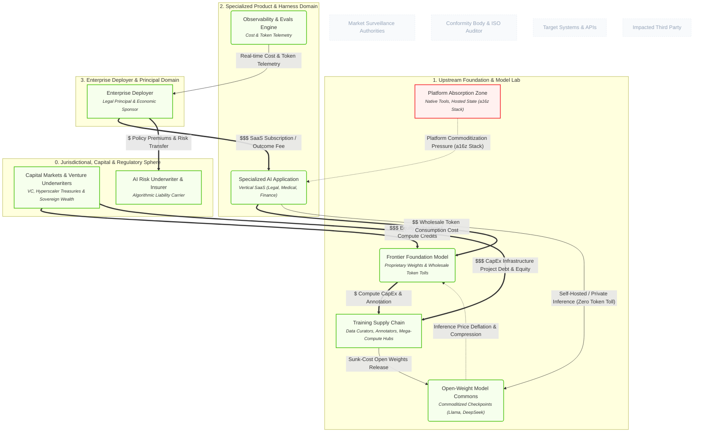

# Understanding AI Economics: Valuations, Corporate Structures, and Revenue Flows

## 1. Executive Summary & Core Thesis
Value in the AI ecosystem does not pool evenly; it behaves as an **asymmetric capital siphon** caught between heavy upstream CapEx and an enterprise return-on-investment (ROI) hurdle. 

The canonical model illustrates that:
1. **Upstream Labs & Infrastructure** survive on a mix of wholesale token tolls and massive **equity/compute subsidies from capital markets** to offset multi-gigawatt training runs.
2. **Specialized Vertical ISVs** face a structural **"SaaS Margin Sandwich"**—squeezed between variable token COGS below and fixed SaaS pricing expectations above, while cloud platforms continually threaten to absorb their features.
3. **Open-Weight Commons** act as a critical macroeconomic deflationary force, depressing the pricing power of proprietary frontier labs and offering ISVs an architectural escape hatch from the per-token toll.

---

## 2. Model Perspective

The diagram below isolates the economic flows and competitive tensions across the five system tiers:

## 3. Systemic Mechanics & Walkthrough

### Tier 1: The Commercial Revenue Waterfall

In a normalized software economy, revenue flows up from the buyer to the application, which passes margin down to suppliers. In the AI ecosystem, this waterfall has distinct friction points:

1. **Enterprise Deployment (N_ENTERPRISE → N_ISV_PRODUCT):** The enterprise deploys capital via traditional SaaS recurring fees or emerging outcome-based contracts. However, the enterprise faces strict ROI payback pressure (the Sequoia "Act Two" hurdle).

2. **Wholesale Token Toll (N_ISV_PRODUCT →  N_FRONTIER):** Unlike traditional software where hosting represents 5–15% of revenue, vertical AI ISVs face variable marginal inference costs that scale with customer usage, degrading gross margins to 40–60%.

3. **CapEx Siphon (N_FRONTIER → N_TRAIN):** Foundation labs channel their token revenues directly into massive, continuous compute CapEx (GPU clusters, power procurement, human reinforcement data).

4. **Risk Transfer (N_ENTERPRISE → N_INSURER):** Enterprise deployers pay insurance premiums to balance-sheet underwriters to offload tort and algorithmic liability exposure.

### Tier 2: The Equity Bridge & Capital Overhang

Commercial revenues alone currently do not cover the massive capital requirements of frontier training runs.

To bridge this gap, **Capital Markets (N_CAPITAL)** inject billions in equity financing, debt facilities, and cloud compute credits directly into N_FRONTIER and N_TRAIN. This creates high multiple valuations for foundation labs, but also generates an aggressive payback imperative: if N_ENTERPRISE does not unlock proportional productivity gains, upstream valuations experience sharp corrections.

### Tier 3: The Deflationary Counterweight (Open Weights)

The emergence of **Open-Weight Models (N_OPEN_MODEL)** breaks the pricing monopoly of proprietary frontier APIs:

- Hyperscalers and research consortia absorb training costs and open-source foundation checkpoints.

- This exerts continuous **downward price pressure** on N_FRONTIER per-token fees.

- It provides N_ISV_PRODUCT with an architectural alternative: replacing variable per-token tolls with predictable, self-hosted GPU cloud instances.

---

## 4. Cybernetic & Strategic Tensions

| Node Pair                   | Economic Friction            | Impact on Company Structure                                                                                                                |
| --------------------------- | ---------------------------- | ------------------------------------------------------------------------------------------------------------------------------------------ |
| N_ISV_PRODUCT vs N_ABSORBED | **Platform Commoditization** | ISVs risk building "thin wrapper" capabilities that frontier labs incorporate as native platform features.                                 |
| N_ISV_PRODUCT vs N_FRONTIER | **Gross Margin Erosion**     | Selling fixed-price subscriptions while paying variable-rate API bills exposes vertical SaaS to negative unit economics during high usage. |
| N_OPEN_MODEL vs N_FRONTIER  | **Price Deflation**          | Near-frontier open weights limit the ability of proprietary labs to charge premium margins for commoditized reasoning tasks.               |
| N_ENTERPRISE vs N_OBSERVE   | **FinOps & Throttling**      | Real-time observability gives enterprise CFOs the telemetry needed to throttle agent autonomy when token spend exceeds value creation.     |

---

## 5. Model Feedback & Audit Trail

- **Entities Evaluated:** N_ENTERPRISE, N_ISV_PRODUCT, N_FRONTIER, N_TRAIN, N_ABSORBED, N_OBSERVE, N_INSURER, N_CAPITAL, N_OPEN_MODEL.

- **Ontological Additions Resolved:**
  
  - Synchronized the capital direction on E_ENT_TO_INSURER_PREMIUM.
  
  - Fully integrated N_CAPITAL and N_OPEN_MODEL with typed LinkML properties.
