# Can Australia's Proposed Frontier AI Safety Regime and Local Model Hosting Realise Sovereign Governance?

## 1. Executive Summary & Core Thesis

On 10 November 2026, the Australian Government announced plans to legislate six mandatory safety and security obligations for frontier AI companies alongside a dedicated regulator working with the Australian AI Safety Institute. Evaluated against the canonical AI Ecosystem Model (`ai_ecosystem_2.yaml`, v3.3), Australia currently possesses System 4 capability-evaluation channels (`N_SAFETY_INSTITUTE`) and ex-post deployer enforcement (`N_REGULATOR` $\rightarrow$ `N_ENTERPRISE`), but lacks active statutory control or rapid incident-reporting edges over offshore frontier labs (`N_FRONTIER_LAB`), which remain scoped exclusively to `[eu]` in the empirical graph. Even after future Australian legislation closes that statutory gap, situating model weights domestically—whether as replicated closed-weight inference fleets (`N_FRONTIER_MODEL`) or self-hosted open-weight instances (`N_OPEN_MODEL`)—cannot deliver full regulatory or operational sovereignty. Closed-weight local copies leave upstream compute chokepoints, offshore weight control, and contractual liability disclaimers (`E_LAB_DISCLAIMS_ENT`) intact, whereas open-weight self-hosting reduces some supplier gating and places more responsibility for controls and evidence production on the deploying enterprise, without by itself determining audit independence (`N_ENTERPRISE`). Realising sovereign governance therefore depends less on where model weights reside and more on deterministic runtime containment (`N_GUARDRAIL`, `N_IDP`, `N_TOOL_GATEWAY`, `N_AUDIT_STORE`) capable of satisfying third-party auditors (`N_AUDITOR`) and algorithmic risk underwriters (`N_INSURER`).

## 2. Model Perspective

```mermaid
flowchart TB
    classDef gov fill:#FFF1F0,stroke:#F5222D,stroke-width:2px;
    classDef econ fill:#F6FFED,stroke:#52C41A,stroke-width:2px;
    classDef tech fill:#E6F7FF,stroke:#1890FF,stroke-width:2px;
    classDef tension fill:#FFF1F0,stroke:#F5222D,stroke-dasharray: 5 5,stroke-width:2px;
    classDef dim fill:#F8FAFC,stroke:#E2E8F0,color:#94A3B8,stroke-dasharray: 3 3;

    %% Dimmed Background Nodes (context)
    N_CAPITAL["Capital Markets & Venture Underwriters<br/><small><i>VC syndicates, hyperscaler equity, sovereign wealth</i></small>"]:::dim
    N_COURTS["Courts & Dispute Resolution<br/><small><i>National and EU courts, arbitration, class-action mechanisms</i></small>"]:::dim
    N_CIVIL_SOCIETY["Civil Society, Researchers & Media<br/><small><i>NGOs, journalists, academic researchers, incident databases, advocacy groups</i></small>"]:::dim
    N_SILICON["Leading-Edge Silicon & Lithography<br/><small><i>ASML (EUV), TSMC (foundry), Nvidia, HBM memory</i></small>"]:::dim
    N_ENERGY_GRID["Energy Grids & Power Generation<br/><small><i>Nuclear PPAs, substation transformers, cooling</i></small>"]:::dim
    N_TRAIN["Training Compute Campuses<br/><small><i>Mega data centers, GW-scale cluster fabric, power substations</i></small>"]:::dim
    N_DATA_RIGHTS["Training Data & Rights Holders<br/><small><i>Publishers, creators, data brokers, annotation vendors, licensing collectives</i></small>"]:::dim
    N_ISV_PRODUCT["AI Applications<br/><small><i>Vertical enterprise solutions (legal, medical, finance, ops) and consumer apps</i></small>"]:::dim
    N_AI_GOVERNANCE["Enterprise AI Governance Function<br/><small><i>AI risk committee, management-system owner, horizon scanning</i></small>"]:::dim
    N_KNOWLEDGE_STORE["Enterprise Semantic Knowledge Base<br/><small><i>Proprietary vector DBs, documents, embeddings</i></small>"]:::dim
    N_HUMAN_USER["Human Task Delegator & Overseer<br/><small><i>End user and mandatory human-in-the-loop supervisor</i></small>"]:::dim
    N_THREAT_ACTOR["Adversaries & Misuse Actors<br/><small><i>Cybercriminals, state actors, prompt-injection attackers, malicious tool publishers</i></small>"]:::dim

    %% Active Sub-System Clusters & Nodes
    subgraph cluster_regulatory["0. Jurisdictional, Capital & Regulatory Sphere"]
        N_LEGISLATURE["Legislatures & Executive Policy-Makers<br/><small><i>EU Parliament & Council, US Congress & executive, national parliaments, ministries</i></small>"]:::gov
        N_REGULATOR["Statutory & Trade Authorities<br/><small><i>EU AI Office & national authorities, FTC/state AGs, BIS export controls, China CAC, UK & APAC regulators</i></small>"]:::gov
        N_SAFETY_INSTITUTE["AI Safety & Security Institutes<br/><small><i>US CAISI (formerly AISI), UK AI Security Institute, Japan AISI, frontier evaluators</i></small>"]:::gov
        N_STANDARDS_BODY["Standards Setting Organisations<br/><small><i>ISO/IEC JTC 1/SC 42, NIST, CEN-CENELEC, IEEE</i></small>"]:::gov
        N_AUDITOR["Conformity & Certification Bodies<br/><small><i>EU notified bodies, ISO/IEC 42001 certifiers</i></small>"]:::gov
        N_INSURER["AI Risk Underwriter & Insurer<br/><small><i>Algorithmic liability and cyber risk carriers</i></small>"]:::econ
    end

    subgraph cluster_supply["1. Upstream Silicon, Energy, Cloud, Data & Model Supply"]
        N_FRONTIER_LAB["Frontier AI Labs<br/><small><i>Organisations that train and release frontier models</i></small>"]:::econ
        N_CLOUD_HYPERSCALER["Hyperscaler Cloud Platform<br/><small><i>Azure, AWS, Google Cloud, OCI</i></small>"]:::econ
        N_FRONTIER_MODEL["Frontier Foundation Model<br/><small><i>Globally replicated weights and inference fleets</i></small>"]:::tech
        N_OPEN_MODEL["Open-Weight Model Commons<br/><small><i>Commoditised weights, distilled checkpoints, local runtimes</i></small>"]:::tech
    end

    subgraph cluster_product["2. Application & Agent Domain"]
        N_AGENT["Agent Runtime<br/><small><i>Plan-act loop: reasoning, tool use, working and episodic state</i></small>"]:::tech
        N_GUARDRAIL["Policy & Guardrail Kernel<br/><small><i>Least privilege, pre-execution authorisation, kill switch, scope limits</i></small>"]:::gov
        N_AUDIT_STORE["Sovereign Audit Ledger<br/><small><i>Tamper-evident WORM state and forensic store</i></small>"]:::tech
        N_OBSERVE["Observability & Evals Engine<br/><small><i>Continuous evaluation, traces, cost telemetry</i></small>"]:::tech
    end

    subgraph cluster_client["3. Enterprise Deployer & Principal Domain"]
        N_ENTERPRISE["Enterprise Deployer<br/><small><i>Legal principal and economic sponsor</i></small>"]:::econ
        N_IDP["Enterprise Identity & Auth (IdP)<br/><small><i>OAuth, OIDC, workload IAM, ephemeral tokens</i></small>"]:::tech
    end

    subgraph cluster_environment["4. Execution Environment, Blast Radius & Adversaries"]
        N_TOOL_GATEWAY["Capability & Tool Gateway<br/><small><i>Decoupled tool broker and context provider (MCP)</i></small>"]:::tech
        N_TARGET_SYS["Target Systems & Operational APIs<br/><small><i>Databases, production ERP, financial rails</i></small>"]:::tech
        N_AFFECTED_PARTY["Affected Individuals & Consumers<br/><small><i>Consumers, employees, citizens</i></small>"]:::gov
    end

    %% Active Edges
    N_LEGISLATURE == "Statutory mandates, powers & funding (S5 to S3)" ==> N_REGULATOR
    N_FRONTIER_LAB -->|"Pre-release model access for red-teaming"| N_SAFETY_INSTITUTE
    N_SAFETY_INSTITUTE -->|"Evaluations & systemic-risk alerts (S4 to S3)"| N_REGULATOR
    N_REGULATOR == "GPAI codes of practice & transparency duties" ==> N_FRONTIER_LAB
    N_FRONTIER_LAB -->|"Mandatory rapid incident notifications (Art. 55 GPAI systemic risk)"| N_REGULATOR
    N_REGULATOR == "Statutory penalties & enforcement" ==> N_ENTERPRISE

    N_FRONTIER_LAB -. "Trains, gates and releases the model" .-> N_FRONTIER_MODEL
    N_FRONTIER_LAB -->|"Open-weight release of sunk-cost models"| N_OPEN_MODEL
    N_CLOUD_HYPERSCALER -->|"Hyperscale inference fleet hosting & orchestration"| N_FRONTIER_MODEL
    N_FRONTIER_LAB -. "Disclaims liability (ToS as-is / recourse gap)" .-> N_ENTERPRISE

    N_AGENT -->|"MIP inference API (tokens & directives)"| N_FRONTIER_MODEL
    N_AGENT -->|"Self-hosted / private open inference (MIP)"| N_OPEN_MODEL
    N_GUARDRAIL -. "Policy envelope & runtime constraints (S3 to S1)" .-> N_AGENT
    N_GUARDRAIL -->|"Tamper-evident decision & action trail (Art. 12)"| N_AUDIT_STORE

    N_AUDIT_STORE -->|"Forensic evidence for compliance verification"| N_AUDITOR
    N_OBSERVE -->|"Behavioural evaluation evidence for continuing surveillance (enterprise-operated)"| N_AUDITOR
    N_AUDITOR -. "Conformity audits & certification" .-> N_ENTERPRISE
    N_AUDITOR -->|"Certification status & scope as an underwriting basis (third-party reliance)"| N_INSURER
    N_INSURER -. "Underwriting gate: audit trail & human oversight required" .-> N_ENTERPRISE

    N_IDP -->|"Credential validation at call time: withdrawn authority stops tool access"| N_TOOL_GATEWAY
    N_AGENT -->|"A2T tool calling & context protocol (MCP / OpenAPI)"| N_TOOL_GATEWAY
    N_TOOL_GATEWAY -->|"Authenticated operations execution"| N_TARGET_SYS
    N_TARGET_SYS -. "Direct impact & real-world blast radius" .-> N_AFFECTED_PARTY
    N_ENTERPRISE -. "Vicarious liability for harm (respondeat superior)" .-> N_AFFECTED_PARTY
```

## 3. Model Mechanics & Walkthrough

### Tier 1: Jurisdictional & Statutory Control (`cluster_regulatory` $\leftrightarrow$ `cluster_supply`)

- **Existing Empirical Mechanisms (`Type 1`):** Within the `F_JURISDICTION` Viable System Model (VSM) frame, Australia (`apac`) already operates a System 4 intelligence loop via `N_SAFETY_INSTITUTE`. `N_FRONTIER_LAB` grants pre-release evaluation access (`E_LAB_TO_SAFETY_EVAL`), allowing `N_SAFETY_INSTITUTE` to feed systemic-risk assessments into `N_REGULATOR` (`E_SAFETY_TO_REG`) and `N_LEGISLATURE` (`E_SAFETY_TO_LEG`).

- **Current Statutory Vacuum in `apac` (`Type 3`):** In `ai_ecosystem_2.yaml`, both binding upstream supplier controls—`E_REG_TO_LAB_GPAI` (*GPAI codes of practice & transparency duties*) and `E_LAB_TO_REG_INCIDENT` (*Mandatory rapid incident notifications*)—carry `jurisdictions: [eu]`. Consequently, as of November 2026, Australia's `apac` projection has zero binding statutory edges directly connecting `N_REGULATOR` and `N_FRONTIER_LAB`. The government's 10 November 2026 announcement represents a prospective `N_LEGISLATURE` policy initiative (`E_LEG_TO_REG_MANDATE`, `delay: years`) to enact `apac`-scoped equivalents of those two edges through future Australian AI Standards legislation.

- **Cross-Border Enforcement Friction (`Type 3`):** Because `N_FRONTIER_LAB` is domiciled across `[us, china, eu, uk]` and anchored to offshore capital (`N_CAPITAL`), lithography (`N_SILICON`), power (`N_ENERGY_GRID`), and training campuses (`N_TRAIN`), an Australian regulator's leverage is confined to domestic market access. If a frontier lab declines local obligations, Australian deployers (`N_ENTERPRISE`) can still reach `N_FRONTIER_MODEL` over global `N_CLOUD_HYPERSCALER` tenancy (`E_ENT_TO_CLOUD`, `E_CLOUD_TO_MODEL_HOSTING`).

### Tier 2: Domestic Model Hosting Modes (`cluster_supply` $\leftrightarrow$ `cluster_product`)

- **Mode A — Local Copies of Closed-Weight Frontier Models (`Type 1` & `Type 3`):** Replicated inference weights are represented by `N_FRONTIER_MODEL` (*Globally replicated weights and inference fleets*), delivered in-country through `N_CLOUD_HYPERSCALER` (*sovereign cloud zones*) via `E_CLOUD_TO_MODEL_HOSTING`. While `N_FRONTIER_LAB` retains release gating (`E_LAB_TO_MODEL_RELEASE`), physical residency in Australia does not confer operational sovereignty: `N_CLOUD_HYPERSCALER` explicitly treats sovereign cloud zones as a commercial `lock_in_mechanism`, `E_AGENT_TO_MODEL_MIP` preserves `target_dominant` power asymmetry and `high` switching costs, and `E_LAB_DISCLAIMS_ENT` leaves `N_ENTERPRISE` bearing full vicarious legal liability (`E_ENT_LIABILITY_AFFECTED`).

- **Mode B — Locally Hosted Open-Weight Instances (`Type 1` & `Type 3`):** Frontier labs release sunk-cost checkpoints via `E_LAB_TO_OPEN_RELEASE` into `N_OPEN_MODEL` (*Open-Weight Model Commons*), enabling `N_AGENT` to execute zero-license-toll local inference via `E_AGENT_TO_OPEN_MODEL_MIP` (`power_asymmetry: source_dominant`, `switching_cost: low`). However, `N_OPEN_MODEL` has zero incoming `statutory_mandate` or `governance_control` edges—even in `[eu]`. Once weights enter the commons and are self-hosted in Australia, upstream vendor gating (`E_LAB_TO_MODEL_RELEASE`) and rapid lab-to-regulator incident telemetry (`E_LAB_TO_REG_INCIDENT`) are structurally severed.

### Tier 3: Runtime Containment, Audit & Insurance (`cluster_product` $\leftrightarrow$ `cluster_client` $\leftrightarrow$ `cluster_environment`)

- **Actuation Blast Radius (`Type 1`):** Across both hosting modes, real-world harm (`E_TARGET_HARM_AFFECTED`) occurs when `N_AGENT` calls operational tools through `N_TOOL_GATEWAY` (`E_AGENT_TO_GATEWAY_A2T`, MCP/OpenAPI) to mutate `N_TARGET_SYS` (`E_GATEWAY_TO_TARGET`). Localizing weights does not mitigate prompt injection or tool poisoning (`E_THREAT_TO_AGENT`); safety depends on pre-execution runtime enforcement via `N_GUARDRAIL` (`E_GUARDRAIL_TO_AGENT`) and call-time credential validation via `N_IDP` (`E_IDP_TO_GATEWAY`).

- **Assurance independence and underwriting under open weights (`Type 3` inquiry):** The `V_ASSURANCE` view represents enterprise evidence flows from `N_AUDIT_STORE` and `N_OBSERVE` to `N_AUDITOR` (`E_AUDIT_TO_AUDITOR`, `E_OBSERVE_TO_AUDITOR`), and a certification-scope input to `N_INSURER` (`E_AUDITOR_TO_INSURER`). These relationships do not establish completeness, independence, or integrity of the evidence. Self-hosting `N_OPEN_MODEL` changes who operates the model and may shift responsibility for its provenance and evaluation, but does not inherently remove independent audit: independent evidence collection, protected custody, and reproducible assessment remain possible. Whether this changes underwriting requirements or premiums is an external empirical and contractual question, not a consequence established by these edges. <!-- claim: C-AU-01 -->

## 4. Technical, Governance & Economic Tensions

| **Tension Axis**                                 | **Engaged Nodes & Edges**                                                                                                                              | **Structural & VSM Conflict**                                                                                                                                                                                                 |
| ------------------------------------------------ | ------------------------------------------------------------------------------------------------------------------------------------------------------ | ----------------------------------------------------------------------------------------------------------------------------------------------------------------------------------------------------------------------------- |
| **Legislative Speed vs. Runtime Speed**          | `N_LEGISLATURE` $\rightarrow$ `N_REGULATOR` (`E_LEG_TO_REG_MANDATE`, `delay: years`) vs. `N_AGENT` $\rightarrow$ `N_TARGET_SYS` (`delay: immediate`)   | Societal VSM System 5/3 feedback loops (`L_B2_HARM_REGULATION`, `L_B4_HARM_ALARM_POLICY`) operate on multi-month to multi-year timescales, whereas agent actuation and harm (`E_TARGET_HARM_AFFECTED`) occur instantaneously. |
| **Jurisdictional Reach vs. Cloud Bypass**        | `N_REGULATOR` $\leftrightarrow$ `N_FRONTIER_LAB` (`[eu]` only) vs. `N_ENTERPRISE` $\rightarrow$ `N_CLOUD_HYPERSCALER` $\rightarrow$ `N_FRONTIER_MODEL` | Domestic frontier obligations only bind entities seeking local market presence; offshore hyperscaler routing allows `N_ENTERPRISE` to consume frontier capabilities outside national regulatory reach.                        |
| **Residency vs. Operational Sovereignty**        | `N_CLOUD_HYPERSCALER` (`sovereign cloud zones`) $\rightarrow$ `N_FRONTIER_MODEL` vs. `E_LAB_DISCLAIMS_ENT`                                             | In-region hosting satisfies data-residency optics while preserving foreign vendor control over weights, pricing (`target_dominant`), and unilateral liability disclaimers.                                                    |
| **Open-Weight Hosting vs. Evidence Independence** | `E_AGENT_TO_OPEN_MODEL_MIP` (`switching_cost: low`) vs. `N_OBSERVE` $\rightarrow$ `N_AUDITOR` $\rightarrow$ `N_INSURER` (`E_INSURER_TO_ENT_GATE`)      | Self-hosting `N_OPEN_MODEL` may reduce supplier dependencies while shifting provenance and control obligations to the deployer. Neither audit independence nor underwriting consequences follow from hosting mode alone.                                    |

## 5. Model Audit & Feedback Trail

- **Entities Tested:** `N_LEGISLATURE`, `N_REGULATOR`, `N_SAFETY_INSTITUTE`, `N_STANDARDS_BODY`, `N_AUDITOR`, `N_INSURER`, `N_FRONTIER_LAB`, `N_FRONTIER_MODEL`, `N_OPEN_MODEL`, `N_CLOUD_HYPERSCALER`, `N_ENTERPRISE`, `N_AGENT`, `N_GUARDRAIL`, `N_AUDIT_STORE`, `N_OBSERVE`, `N_IDP`, `N_TOOL_GATEWAY`, `N_TARGET_SYS`, `N_AFFECTED_PARTY`.

- **Ontological Gaps Identified:**
  
  - **Resolved in `ai_ecosystem_2.yaml` (v3.3):** Two `Type 2` gaps surfaced during this inquiry were incorporated into v3.3: (1) edge-level `jurisdictions` scoping on `E_REG_TO_LAB_GPAI`, `E_LAB_TO_REG_INCIDENT`, and `E_AFFECTED_TO_REG_COMPLAINT` (`[eu]`), enabling the model to represent active European statutory duties without falsely attributing prospective Australian legislation to `apac`; and (2) `E_AGENT_TO_OPEN_MODEL_MIP`, directly linking `N_AGENT` to `N_OPEN_MODEL` over the `mip` protocol plane.
  
  - **Distinguished as `Type 3` Real-World Vulnerabilities (No Synthetic Edges Added):** The absence of an Australian statutory lab-to-regulator incident channel (`apac`), the lack of upstream governance over `N_OPEN_MODEL`, and the lack of cryptographic AI-BOM/weight attestation between `N_OPEN_MODEL` and `N_AUDITOR` were verified as empirical gaps in real-world law and auditing practice rather than model defects.
  
  - **Remaining Minor `Type 2` Refinements Logged for Future Schema/Instance Iteration:**
    
    1. Add `normative_status: binding` and `us_ca` (California SB 53) to `E_LAB_TO_REG_INCIDENT`, and wire it into a fast-path balancing loop in `loops:`.
    
    2. Apply explicit `jurisdictions: [eu]` tags to remaining EU AI Act-specific edges (`E_GUARDRAIL_TO_AUDIT`, `E_USER_TO_AGENT_HITL`, `E_REG_TO_ISV_HIGH_RISK`).
    
    3. Add an optional `routing_scope` (`in_region` vs. `global`) attribute on `E_CLOUD_TO_MODEL_HOSTING` to distinguish data-residency zones from global inference endpoints without conflating residency with operational sovereignty.
