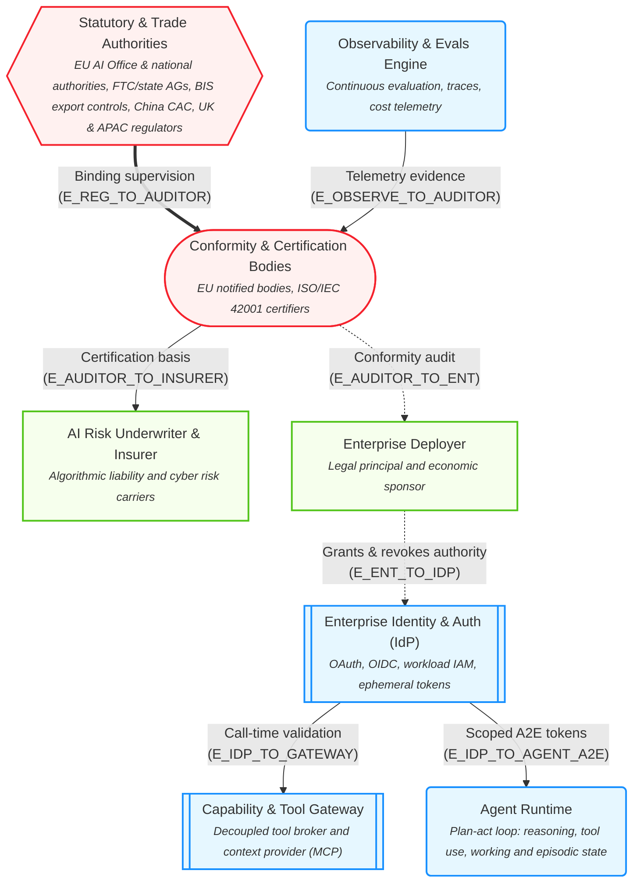

# Continuing Assurance: Can We Still Trust Yesterday's Approval Today?

## The Question

> **"AI models, agent runtimes, and execution tools update constantly. How does the ecosystem ensure that approvals, insurance, and safety checks remain valid over time—and how does the architecture pull permissions when something goes wrong?"**

---

## The Interactive View

Select the **Continuing Assurance** (`V_ASSURANCE`) view in the interactive graphic below. With that view selected, the non-participating nodes in the wider ecosystem are dimmed into the background, highlighting supervisory relationships, evidence and complaint routes, and delegated-authority controls:

  <iframe
    src="/viewer/?view=V_ASSURANCE&inquiry=assurance" 
    width="100%" 
    height="100%" 
    style={{ border: '1px solid #282d3c', borderRadius: '8px', backgroundColor: '#14161d' }} 
    title="Continuing Assurance Interactive View"
  ></iframe>

*(Tip: Click on `N_AUDITOR`, `N_REGULATOR`, or `N_IDP` in the viewer above to inspect their VSM frame roles, Ashby variety, and connected edges).*

---

## The Sense-Making Context: The Point-in-Time Fallacy

A point-in-time assessment at deployment (*T0*) cannot, by itself, establish that the assessed conditions continue to hold. Conformity assessment and management-system certification can involve surveillance and reassessment; the problem is the possible divergence between the current operating system and the scope and evidence supporting an earlier determination.

In the AI ecosystem, that divergence can arise as systems change. Autonomous systems drift across three dimensions:
1. **Model Drift & Evals:** Foundation model inference endpoints (`N_FRONTIER_MODEL`) receive upstream weight updates, prompt mitigations, and latency-optimized distillation.
2. **Context & Tool Poisoning:** Agent reasoning loops dynamically consume external tools (`N_TOOL_GATEWAY`) and vector retrieval data, expanding their operational blast radius.
3. **Adversarial Exploitation:** New prompt injection vectors (`N_THREAT_ACTOR`) emerge post-deployment.

If assurance evidence is not refreshed when conditions materially change, a formally current certificate may no longer justify the same reliance. Continuing evaluation, independent scrutiny where available, and effective enforcement of delegated authority are relevant controls, but their actual operation and consequences require separate evidence.

---

## Architectural Mechanisms in the Model

The model represents several pathways relevant to continuing assurance; their presence does not establish that they form closed or effective feedback loops:

### 1. Supervisory Reassessment & Suspension
Edge `E_REG_TO_AUDITOR` represents recognition, supervision, potential suspension of conformity bodies, and regulator-required reassessment after incidents. The applicability and exercise of those powers depend on the legal regime and circumstances. Supervising a conformity body is distinct from changing an individual certificate's formal status, or determining whether its underlying evidence remains applicable.

### 2. Evidence and External Reporting Pathways
Can adverse evidence reach actors competent to reassess an existing determination, and is that evidence sufficiently independent?
* **Enterprise-operated telemetry:** `E_OBSERVE_TO_AUDITOR` carries behavioral evaluation evidence to `N_AUDITOR`. It establishes an evidence route, not independent verification, since the evaluation is enterprise-operated. <!-- claim: C-ASSURANCE-01 --> `E_AUDIT_TO_AUDITOR` likewise supplies audit-store evidence without establishing its completeness.
* **Affected-party complaints:** `E_AFFECTED_TO_REG_COMPLAINT` brings complaints to `N_REGULATOR`; `E_REG_TO_AUDITOR` represents supervisory powers that may be used in response. The path does not guarantee investigation, a changed determination, or timely enforcement.
* **Civil-society and policy attention:** `E_CIVIL_TO_LEG_ALARM` represents reports reaching `N_LEGISLATURE`, while `E_LEG_TO_REG_MANDATE` represents the legislature's authority over regulators. These are routes for public and institutional pressure, not automatic changes in statutory powers or assurance outcomes. Both relationships carry delays in the canonical model.

External reporting bypasses the enterprise's internal management channel, but the source, integrity, evaluation, and legal significance of the resulting evidence remain separate questions.

### 3. Third-Party Economic Reliance
`E_AUDITOR_TO_INSURER` represents certification status and scope informing an insurer's underwriting assessment. `E_INSURER_TO_ENT_GATE` represents contractual underwriting requirements for audit trails and human oversight. A restriction or withdrawal of certification may prompt reassessment of cover or deployment risk, but neither edge establishes automatic policy lapse, coverage denial, or cessation of operation. Those outcomes depend on the applicable contract, decisions, and enforcement.

### 4. Delegated-Authority Controls and Their Limits
When an enterprise principal withdraws delegated authority, which execution paths actually enforce that change? Disabling an agent's instructions alone may leave previously issued credentials or alternative access paths usable.

The model represents three relevant relationships:
1. **Authority governance:** `E_ENT_TO_IDP` connects `N_ENTERPRISE` to `N_IDP` for granting, scoping, and revoking delegated authority.
2. **Workload credentials:** `E_IDP_TO_AGENT_A2E` represents A2E workload identity delegation to `N_AGENT`.
3. **Gateway verification:** `E_IDP_TO_GATEWAY` represents credential validation at call time by `N_TOOL_GATEWAY`.

These edges describe controls that can prevent calls made without current authority **when the gateway mediates the execution path and validates the relevant status**. They do not establish universal mediation, revocation propagation latency, coverage of alternate credentials, or that every `N_TARGET_SYS` rejects an unauthorized action. In particular, a change in an assurance determination does not automatically revoke an agent's delegated authority in the graph.

### Strategic Takeaways for Leaders & Architects

1. **Assess continuing applicability:** Certificate status and the adequacy of evidence for the present configuration are distinct. `N_OBSERVE` and `N_AUDIT_STORE` can supply evidence, but completeness, independence, and reassessment consequences remain to be established.

2. **Separate reporting from determination:** Complaints and public alarms can reach supervisory actors without passing through enterprise management. Reachability alone does not establish evidence credibility, investigation, or an enforceable decision.

3. **Test the execution boundary:** The `N_IDP` and `N_TOOL_GATEWAY` relationships represent delegated-authority controls. Their effectiveness depends on actual mediation, credential validity checks, and coverage of relevant execution paths.

---

## Model Audit & Feedback Trail

- **Entities Tested:** `N_REGULATOR`, `N_AUDITOR`, `N_OBSERVE`, `N_AUDIT_STORE`, `N_INSURER`, `N_ENTERPRISE`, `N_AFFECTED_PARTY`, `N_CIVIL_SOCIETY`, `N_LEGISLATURE`, `N_IDP`, `N_AGENT`, and `N_TOOL_GATEWAY`.
- **Grounding & Evidence Limits:** The canonical graph represents supervision, evidence routes, insurance reliance inputs, and identity-based control pathways. It does not by itself prove that reported harm changes an assurance determination, that coverage lapses, or that every execution path enforces a revoked delegation.
- **Ontological Gaps Identified:** No specific model addition is established by this inquiry revision. Questions about certificate-state transitions, independent evidence, and actual control effectiveness remain open for further model-grounded and external examination; their absence from this description is not itself proof of a real-world failure.