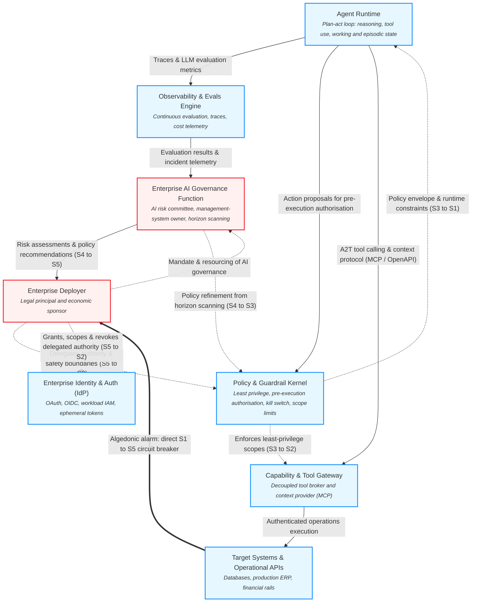

# When Governance Knows, Who Can Change What an Agent Does?

## 1. Executive Summary & Core Thesis

The canonical model connects agent evaluation evidence to enterprise AI governance, governance policy refinement to the guardrail kernel, and guardrail constraints to agent execution. It also places the enterprise principal, not its governance function, at S5 policy authority in `F_ENTERPRISE`. Removing the governance function leaves several operational controls intact; removing only its direct guardrail-refinement edge leaves an indirect route through advice to the enterprise and a separate delegation decision. **The represented feedback and control paths are real features of the model, but connectivity alone establishes neither effective authority for a particular intervention nor successful runtime enforcement.** The consequential question is who may change a control, on what evidence, and through which execution boundary.

## 2. Model Perspective

The diagram traces canonical relationships, not an asserted end-to-end authorization protocol. A data-flow edge carrying advice must not be interpreted as a governance-control edge; neither relationship implies that an intervention has been approved or executed.

In the enterprise VSM frame (`F_ENTERPRISE`), `N_AI_GOVERNANCE` is S4 intelligence, `N_ENTERPRISE` is S5 policy, `N_GUARDRAIL` is S3 control, `N_OBSERVE` is S3* audit, and `N_AGENT` and `N_TARGET_SYS` are S1 operations. The model also assigns `N_TOOL_GATEWAY` and `N_IDP` to S2 coordination. These are viewpoint-relative analytical roles, not a certificate that the corresponding functions operate effectively in every deployment.

## 3. Model Mechanics & Walkthrough

### Evidence reaches governance

Agent traces and evaluation metrics flow to `N_OBSERVE` via `E_AGENT_TO_OBSERVE`. Evaluation results and incident telemetry reach `N_AI_GOVERNANCE` via `E_OBSERVE_TO_GOV`. These relationships represent a feedback channel from operation to governance intelligence. They do not establish the completeness, provenance, independence, latency, or sufficiency of the evidence for a particular decision.

### Governance influence and enterprise authority are distinct

`E_ENT_TO_GOV` represents the enterprise's mandate and resourcing of AI governance. `E_GOV_TO_GUARDRAIL` directly represents policy refinement from S4 to S3, while `E_GOV_TO_ENT_ADVICE` represents assessments and recommendations from S4 to S5. In turn, `E_ENT_TO_GUARDRAIL` represents S5 delegation of authority and safety boundaries to S3, with a modelled delay of **months**. The model therefore contains both a direct policy-refinement relationship and a route through enterprise decision-making. It does **not** specify which interventions are within the governance function's delegated remit and which require a new enterprise decision.

### Operational control and consequence

`E_AGENT_TO_GUARDRAIL` represents pre-execution action proposals; `E_GUARDRAIL_TO_AGENT` represents runtime constraints with a modelled **immediate** delay. `E_GUARDRAIL_TO_GATEWAY` constrains tool-call scope, while `E_AGENT_TO_GATEWAY_A2T` and `E_GATEWAY_TO_TARGET` represent the execution path to operational systems. These edges describe control and actuation relationships. The graph does not verify that all consequential operations use these paths, that policy updates have propagated, or that bypasses are absent. `E_ENT_TO_IDP` separately represents the enterprise's ability to grant, scope, and revoke delegated authority; it must not be conflated with S4 policy refinement.

### Counterfactual A: Remove enterprise AI governance

Remove `N_AI_GOVERNANCE` and its incident edges from the model for analytical purposes. Four edges disappear: `E_ENT_TO_GOV`, `E_OBSERVE_TO_GOV`, `E_GOV_TO_GUARDRAIL`, and `E_GOV_TO_ENT_ADVICE`. The model loses its assigned enterprise S4 node and the represented route by which observability evidence reaches that function. However, `E_ENT_TO_GUARDRAIL`, `E_GUARDRAIL_TO_AGENT`, and the direct `E_ALGEDONIC_TARGET_ENT` alarm from operational systems to the enterprise remain. Thus **removing adaptive governance does not remove every enterprise control or alarm**. The VSM role gap is a structural model result; it is not by itself evidence that any real-world enterprise lacks such a function.

### Counterfactual B: Remove only direct S4 policy refinement

Remove `E_GOV_TO_GUARDRAIL` analytically while keeping `N_AI_GOVERNANCE`. No direct governance-control edge remains from S4 to the guardrail. The graph still contains the directed, mixed-semantics route `E_GOV_TO_ENT_ADVICE` (**data_flow**) followed by `E_ENT_TO_GUARDRAIL` (**governance_control**, modelled **months** delay). This is a route for advice followed by an enterprise control decision, not a surviving direct S4 authority mandate. The counterfactual is a graph-path test; the repository's existing `--remove` option removes nodes, not individual edges.

## 4. Technical, Governance & Economic Tensions

| Distinction | What the model represents | What remains to be established |
| --- | --- | --- |
| S4 intelligence versus S5 authority | Governance receives evidence, refines policy, and advises the enterprise. | Decision rights and approvals for consequential changes. |
| Direct refinement versus mediated change | An S4-to-S3 refinement edge and a separate S4-to-S5-to-S3 path both exist. | Whether the two paths carry different authorization requirements, and when each is used. |
| Evidence route versus assurance | Evaluation data reaches governance. | Evidence completeness, independence, timeliness, and fitness for the decision. |
| Control propagation versus enforcement | Guardrail constraints and gateway execution routes are represented. | Actual mediation, update propagation, and coverage of alternate execution paths. |
| Organizational versus runtime delay | S5-to-S3 delegation has a months delay; S3-to-S1 constraints have an immediate delay. | Actual intervention time and whether authority can be updated quickly enough for the risk. |
| Economic exposure | The enterprise retains legal and commercial exposure through relationships elsewhere in the model. | Whether expected loss or contractual obligations actually induce a specific control decision. |

The delay contrast is an explanatory clue, **not** a measured service-level claim. Nor does the model declare this S4-to-S3 pathway as one of its named feedback loops. A plausible cycle should not be assigned a new canonical loop ID without separate modelling justification.

## 5. Model Audit & Feedback Trail

- **Entities Tested:** `N_AGENT`, `N_OBSERVE`, `N_AI_GOVERNANCE`, `N_ENTERPRISE`, `N_GUARDRAIL`, `N_TOOL_GATEWAY`, `N_TARGET_SYS`, `N_IDP`, The primary structural reference is `F_ENTERPRISE`.
- **Represented mechanisms (Type 1 at the model level):** Evidence flow to governance, policy refinement, enterprise advice and delegation, guardrail constraints, gateway execution, and target-system alarms. This classification describes canonical graph structure, not independent empirical proof that every deployment implements those controls.
- **Counterfactual findings:** Removing `N_AI_GOVERNANCE` deletes four incident edges but preserves enterprise control and alarm paths. Removing `E_GOV_TO_GUARDRAIL` leaves a mixed advice/control route, not an uninterrupted authority chain.
- **Grounding & Evidence Limits:** No claim is made that recommendations automatically bind S5, that S4 possesses unrestricted authority, or that gateway presence guarantees effective prevention. The model's delay values are qualitative. Real-world deployment evidence would be needed to distinguish an ineffective implementation (potential Type 3) from mere limits of graph representation.
- **Ontological Gaps Identified:** **None established.** Decision-right scope and intervention conditions are worth testing against concrete practice; their omission from this level of abstraction does not yet justify a new node, relationship, or proposed issue. Do not add an edge merely to make the model appear to enforce a preferred governance architecture.
