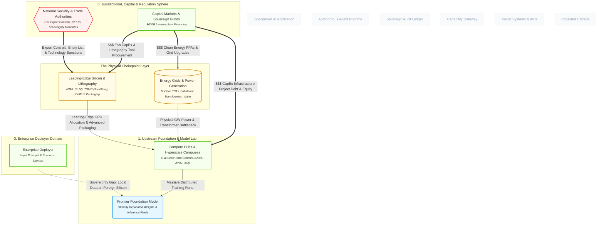

# Where are the Critical Physical and Geopolitical Supply-Chain Chokepoints in the AI Ecosystem?

## 1. Executive Summary & Core Thesis
Conventional AI discourse treats AI as a cloud-based software abstraction governed by algorithmic breakthroughs and software APIs. 

The canonical model exposes this framing as an illusion. The entire global AI ecosystem is governed by an extreme **cardinality inversion (Ashby's Variety in Reverse)**: while downstream software agent invocations number in the billions ($10^9$) across hundreds of thousands of commercial deployers ($10^5$), the entire physical foundation converges into an apex of **monopolistic manufacturing chokepoints ($10^0$)** and **rigid physical electrical grids ($10^2$)**.

True sovereignty and strategic vulnerability do not reside in the software weights or local data residency laws; they are determined by:
1. **Extreme Lithography Concentration:** Complete physical dependence on ASML (extreme ultraviolet optics) and TSMC (3nm/2nm foundries and CoWoS advanced packaging).
2. **The Ampere's Law Bottleneck:** Electrical substation transformer lead times (3–5 years) and gigawatt grid interconnect queues that act as a hard physical speed limit on data-center scaling.
3. **The Fiction of Data Residency:** Storing customer data within national borders provides zero jurisdictional independence if the underlying inference silicon is subject to foreign extraterritorial export controls.

---

## 2. Model Perspective

The diagram below isolates the upstream physical foundation from the downstream application runtime, showing how capital and statutory mandates interact at the physical bottleneck:



## 3. Systemic Mechanics & Walkthrough

### 1. The Inverted Pyramid of Variety (Ashby in Reverse)

In Stafford Beer’s cybernetics, **Ashby's Law of Requisite Variety** states that control requires variety to absorb disturbances. When looking at the physical supply chain, we see the inverse: extreme vulnerability via **hyper-concentration**:

Text

```
[Downstream Invocations & Agents]      10^8 - 10^9 invocations/year
       ▲
[Commercial Deployers]                 10^5 enterprises globally
       ▲
[Vertical SaaS Applications]           10^4 specialized ISVs
       ▲
[Frontier Model Labs]                  Top 5-10 research labs
       ▲
[Energy Grids & Utility Nodes]         10^2 regional interconnection queues
       ▲
[Semiconductor Monopolies]             10^0 - 10^1 (ASML, TSMC, Nvidia)
```

The entire $600B global AI capital cycle rests on a needlepoint of single-digit physical entities.

### 2. The Silicon Chokepoint — N_SILICON_CHOKEPOINT

- **Single Point of Failure (Lithography):** All leading-edge training and inference silicon (\<5nm) relies on Extreme Ultraviolet (EUV) photolithography machines produced by a single company in Veldhoven, Netherlands (**ASML**).

- **Single Point of Failure (Foundry & Packaging):** Over 90% of advanced AI accelerators are fabricated and packaged using proprietary chip-on-wafer-on-substrate (CoWoS) technology by **TSMC in Hsinchu and Tainan, Taiwan**.

- **Geopolitical Weaponization (N_REGULATOR):** National trade authorities (e.g., the US Bureau of Industry and Security) enforce extraterritorial Export Administration Regulations (EAR) on this node, using advanced computing thresholds (e.g., interconnect bandwidth and total processing performance) to legally blockade adversary nations from acquiring leading-edge clusters.

### 3. The Energy Grid Ceiling — N_ENERGY_GRID

- **The Speed Limit on Scaling:** While software deployment takes seconds, electrical infrastructure operates on multi-year industrial cycles:
  
  - High-voltage substation transformers: **3–5 year manufacturing backlog**.
  
  - Utility interconnection queue approvals: **4–7 years in PJM, ERCOT, and European grids**.

- **The Nuclear & Clean Power Shift:** Because training runs of 10<sup>26</sup> to 10<sup>27</sup> FLOPs require 100MW–1GW of continuous, non-intermittent baseline power, hyperscalers are bypassing public utility auctions by executing long-term private Power Purchase Agreements (PPAs) with dedicated nuclear plants and small modular reactor (SMR) developers.

- **Negative Feedback Polarity:** The relationship E_ENERGY_TO_TRAIN_CONSTRAINT carries a **negative (-) polarity**: as compute cluster demand accelerates, local grid capacity acts as a dampening feedback loop that halts physical construction regardless of available financial capital (N_CAPITAL).

### 4. The Data Residency Illusion

Many sovereign states (e.g., in the EU, Australia, and the Middle East) have enacted strict data residency laws requiring public-sector and enterprise data to remain within geographic borders.

The model exposes why **data residency does not equal technological sovereignty**:

- If an enterprise (N_ENTERPRISE) runs an on-premise or sovereign-cloud data center using Nvidia accelerators fabricated by TSMC on ASML tools, its operational continuity remains 100% dependent on foreign firmware updates, foreign spare-part supply chains, and foreign export licenses.

- A disruption in the Taiwan Strait or a statutory export revocation by N_REGULATOR halts operations just as effectively as a cloud outage.

---

## 4. Cybernetic & Geopolitical Tensions

| Node Pair                                                      | Structural Tension                     | Strategic / Economic Consequence                                                                                                                                                                   |
| -------------------------------------------------------------- | -------------------------------------- | -------------------------------------------------------------------------------------------------------------------------------------------------------------------------------------------------- |
| N_REGULATOR → N_SILICON_CHOKEPOINT | **Extraterritorial Sanctions**         | Export bans prevent foundries from servicing certain global markets, fragmenting the global compute supply chain into domestic bifurcated ecosystems.                                              |
| N_ENERGY_GRID → N_TRAIN            | **Physical Infrastructure Bottleneck** | Capital investment cannot convert into operational inference capacity until physical high-voltage substations and cooling permits are cleared.                                                     |
| N_CAPITAL → N_SILICON_CHOKEPOINT   | **Capital Intensity Overhang**         | Constructing a single leading-edge 2nm mega-fab costs upwards of $20B; failure of frontier labs to generate commercial software ROI creates systemic debt risks for semiconductor project finance. |
| N_ENTERPRISE → N_FRONTIER          | **Sovereignty Decoupling**             | Deployers are caught between strict domestic regulatory compliance (e.g., EU AI Act, privacy) and total physical dependence on a concentrated foreign hardware oligopoly.                          |

---

## 5. Model Feedback & Audit Trail

- **Entities Evaluated:** N_SILICON_CHOKEPOINT, N_ENERGY_GRID, N_CAPITAL, N_REGULATOR, N_TRAIN, N_FRONTIER, N_ENTERPRISE, N_AFFECTED_PARTY.

- **Ontological Additions Resolved:**
  
  - Created N_SILICON_CHOKEPOINT to separate semiconductor fabrication and EUV tool manufacturing from general data-center training campuses.
  
  - Created N_ENERGY_GRID to represent physical electrical interconnects, nuclear power contracts, and transformer manufacturing constraints.
  
  - Added corresponding export control (statutory_mandate) and energy ceiling (liability_exposure) edges.