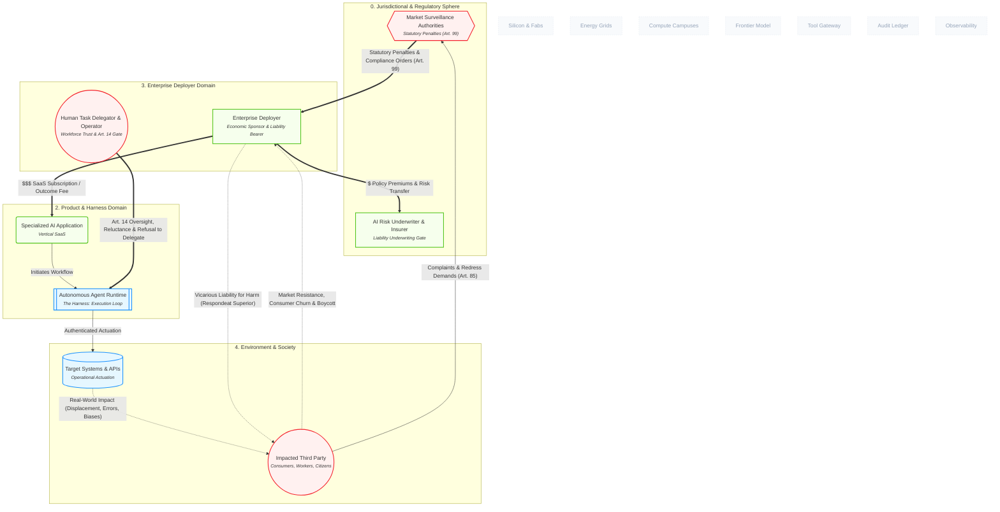

# How Do Public Trust and Social Acceptance Influence AI Adoption?

## 1. Executive Summary & Core Thesis
In mainstream market forecasts, AI adoption is frequently modeled as an inevitable technological push driven by capital investment and algorithmic scaling. 

The canonical model exposes this assumption as an incomplete systemic view. In cybernetic terms, **public trust and social acceptance act as the non-negotiable carrying capacity (environmental ceiling) of the AI ecosystem**.

Adoption operates through three interconnected balancing feedback loops:
1. **Direct Market Rejection:** Consumers and citizens (`N_AFFECTED_PARTY`) who perceive autonomous systems as predatory, deceptive, or unsafe exercise direct commercial agency via **customer churn, boycotts, and brand equity destruction**, hitting the deployer's balance sheet directly.
2. **Democratic Statutory Redress:** When harms accumulate in the real-world blast radius, public outrage channels into regulatory intervention (`N_REGULATOR`), resulting in compliance stop-orders, enforcement penalties, and mandatory moratoriums.
3. **Internal Workforce Resistance:** Inside the enterprise, human operators (`N_HUMAN_USER`) gate adoption through **Article 14 Human Oversight**. If workers fear deskilling, displacement, or liability for hallucinated decisions, algorithm aversion leads to passive subversion and workflow workarounds that destroy the expected return on investment (ROI).

---

## 2. Model Perspective

The diagram below highlights the socio-technical feedback loops that govern whether enterprise capital expenditure converts into durable, trusted adoption:

---

## 3. Systemic Mechanics & Walkthrough

### 1. The Three Damping Loops of AI Adoption

In cybernetic modeling, an unchecked reinforcing loop leads to exponential runaway behavior, which is inevitably bounded by balancing (*B*) loops imposed by the external environment (ENVIRONMENT).

In our model, three distinct damping loops regulate the pace of adoption:

#### Loop A: The Direct Market Feedback Loop (*Bmarket​*)

- **The Pathway:** Target Systems → Impacted Citizens → Enterprise Deployer.

- **Mechanism:** When autonomous systems produce uncalibrated outcomes (e.g., automated denial of health insurance claims, unhelpful customer service loops, algorithmic wage discrimination), consumers experience immediate dissatisfaction.

- **Economic Leverage:** Because consumers have low switching costs (switching_cost: low), they abandon firms adopting aggressive autonomous automation in favor of human-supported or trusted alternatives. This directly depresses the enterprise deployer’s revenue waterfall, invalidating the business case for further software licensing (N_ISV_PRODUCT).

#### Loop B: The Statutory Redress Loop (*Bstatutory​*)

- **The Pathway:** Target Systems → Impacted Citizens → Regulators→Enterprise Deployer.

- **Mechanism:** Where market mechanisms fail (e.g., monopolistic public utilities or welfare allocation), citizens exercise democratic rights under statutory frameworks (such as EU AI Act Article 85: Right to lodge a complaint).

- **Governance Impact:** Accumulated complaints trigger market surveillance audits, civil lawsuits, and administrative penalties up to 7% of global turnover (Article 99). Faced with uninsurable balance-sheet risk, the deployer’s board (VSM System 5) freezes or scales back autonomous operations.

#### Loop C: The Workforce Friction Loop (*Bworkforce​*)

- **The Pathway:** Enterprise → Human Operators → Harness Runtime.

- **Mechanism:** Inside the firm, adoption depends on natural persons (N_HUMAN_USER) delegating real tasks to software agents.

- **The Trust Gap:** If employees perceive that agents threaten their job security, degrade their craft through deskilling, or expose them to professional liability for errors they cannot interpret, they exhibit **algorithm aversion**.

- **The Operational Bottleneck:** Workers make extensive use of the Article 14 "Human-in-the-Loop" stop button, demand manual verification on every step, or circumvent the AI tool entirely. The anticipated productivity boost fails to materialize, stalling enterprise-wide expansion.

---

## 4. Cybernetic & Market Tensions

| Node Pair                                                   | Interaction Type                          | Cybernetic & Strategic Dynamic                                                                                                                               |
| ----------------------------------------------------------- | ----------------------------------------- | ------------------------------------------------------------------------------------------------------------------------------------------------------------ |
| N_AFFECTED_PARTY → N_ENTERPRISE | **Social License Friction**               | Public perception acts as a hard boundary condition: deploying autonomous systems without transparency revokes the firm's commercial social license.         |
| N_HUMAN_USER → N_HARNESS        | **Algorithm Aversion vs Automation Bias** | If trust is too low, workers reject the system; if trust is uncritically high, workers succumb to automation bias, failing to catch catastrophic edge cases. |
| N_TARGET_SYS → N_AFFECTED_PARTY | **Blast Radius Causation**                | Autonomous agents execute real-world write operations at digital speed; uncontained blast radius directly erodes the trust baseline of the deployer.         |
| N_ENTERPRISE → N_INSURER        | **Insurability of Public Outrage**        | Underwriters refuse to insure deployments where reputational blowback or class-action tort claims exceed actuarial boundaries.                               |

---

## 5. Model Feedback & Audit Trail

- **Entities Evaluated:** N_ENTERPRISE, N_ISV_PRODUCT, N_HARNESS, N_HUMAN_USER, N_TARGET_SYS, N_AFFECTED_PARTY, N_REGULATOR, N_INSURER.

- **Ontological Gap Resolved:**
  
  - Added E_AFFECTED_TO_ENT_CHURN to model direct, unmediated market backlash (consumer churn, brand damage, boycotts) separate from formal statutory complaints.
  
  - Verified that public acceptance acts as an environmental constraint (VSM Level *n+1*) bounding enterprise adoption.
