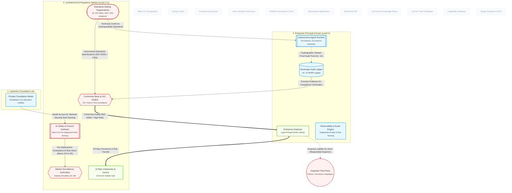

# How Effective are Standards and Certification Mechanisms in Reducing Systemic Risk?

## 1. Executive Summary & Core Thesis
In the AI governance architecture, technical standards and third-party conformity certifications serve as an indispensable **cybernetic variety filter**, but an incomplete **operational safety mechanism**.

The model reveals an acute **Compliance Paradox**:
1. **Macro Success (Variety Attenuation):** Standards organizations (`N_STANDARDS_BODY`) and conformity auditors (`N_AUDITOR`) solve Ashby's variety problem. Without them, statutory authorities ($10^1$ jurisdictions) could never supervise $10^5$ commercial deployers and $10^9$ annual agent invocations.
2. **Runtime Failure (The Temporal Gap):** Certifications (such as ISO/IEC 42001 or CE conformity assessments) are **static, point-in-time snapshot audits (VSM System 3\*)**. Because systemic AI risk is non-deterministic, emergent, and driven by runtime tool actuation, an enterprise deployer (`N_ENTERPRISE`) can maintain a flawless certification posture while operating autonomous loops that trigger severe real-world harm.

Standards and certifications establish essential governance hygiene and unlock market insurability, but they do not substitute for live, independent behavioral telemetry and runtime circuit breakers.

---

## 2. Model Perspective

The diagram below highlights the standards setting, conformity assessment, and liability-shielding mechanisms across the ecosystem:

## 3. Systemic Mechanics & Walkthrough

### 1. Ashby's Law of Requisite Variety in Action

In Stafford Beer's Viable System Model, System 5 (statutory governance) cannot directly absorb the operational variety of System 1 (billions of agent invocations).

To prevent systemic regulatory failure, the ecosystem deploys **variety attenuators**:

- N_STANDARDS_BODY (ISO/IEC JTC 1/SC 42, NIST, CEN-CENELEC) condenses ambiguous legal imperatives (e.g., "appropriate data governance" or "adequate human oversight") into concrete, auditable clauses.

- N_AUDITOR acts as a decentralized verification proxy. The regulator only inspects the accredited auditor; the auditor inspects the enterprise; the enterprise manages the agent.

### 2. The Four Failure Modes of Certification

#### A. The Temporal Gap (Point-in-Time vs. Runtime Drift)

- **The Mechanism:** Conformity assessment is an annual or bi-annual snapshot audit (**VSM System 3***).

- **The Vulnerability:** High-risk AI systems deviate dynamically after deployment. A foundation model's weights may remain unchanged, but external APIs drift, retrieval databases (N_KNOWLEDGE_STORE) ingest poisoned context, and autonomous agent loops (N_HARNESS) encounter novel multi-step edge cases. A system certified safe at *T0* can experience catastrophic behavioral failure at *T1*.

#### B. The S3* Audit Independence Pathology

- **The Mechanism:** N_AUDITOR validates compliance using documents and logs provided by the deployer (E_AUDIT_TO_AUDITOR_EVIDENCE).

- **The Vulnerability:** N_AUDIT_STORE is fed directly by N_HARNESS—the very runtime being governed. Unless an auditor conducts independent, adversarial behavioral probes (the role fulfilled by N_OBSERVE), auditors can only inspect what the audited entity chose to record.

#### C. Standards Latency vs. S4 Horizon Velocity

- **The Mechanism:** Consensus-based standards development cycles require 3 to 5 years from working draft to formal publication.

- **The Vulnerability:** As shown in the model, frontier laboratories (N_FRONTIER) release new capabilities across months, not years. By the time a harmonized European standard (hEN) is ratified, the technical paradigm has shifted from discrete prompt-completion APIs to multi-agent autonomous delegation networks (A2A).

#### D. The "Due Diligence" Certification Shield

- **The Mechanism:** When an autonomous system causes tort or discriminatory harm to an impacted citizen (N_AFFECTED_PARTY), N_ENTERPRISE presents its ISO/IEC 42001 certificate in court to rebut negligence claims.

- **The Vulnerability:** Because upstream labs disclaim operational liability via ToS (contractual_term disclaimers), certification risks becoming a legal insulation device for deployers, blunting the tort law feedback loop that would otherwise drive safety investments.

---

## 4. Cybernetic & Economic Tensions

| Node Pair                                                    | Interaction Type              | Cybernetic & Market Dynamic                                                                                                                                                  |
| ------------------------------------------------------------ | ----------------------------- | ---------------------------------------------------------------------------------------------------------------------------------------------------------------------------- |
| N_STANDARDS_BODY → N_AUDITOR     | **Harmonization vs Rigidity** | Prescriptive standards make auditing measurable, but freeze technical controls in outdated paradigms that cannot respond to novel threat vectors.                            |
| N_ENTERPRISE → N_INSURER         | **Economic Forcing Function** | Insurers act as the true enforcers: enterprise compliance is driven primarily by the requirement to secure balance-sheet liability underwriting.                             |
| N_SAFETY_INSTITUTE → N_REGULATOR | **Macro S4 Intelligence**     | National safety institutes provide the early horizon scanning that static standards bodies lack, testing frontier weights before public release.                             |
| N_FRONTIER → N_STANDARDS_BODY    | **Regulatory Capture**        | Hyperscalers and foundation labs dominate technical working groups, drafting specifications that favor capital-intensive proprietary architectures over open-source commons. |

---

## 5. Model Feedback & Audit Trail

- **Entities Evaluated:** N_REGULATOR, N_STANDARDS_BODY, N_SAFETY_INSTITUTE, N_AUDITOR, N_INSURER, N_FRONTIER, N_ENTERPRISE, N_HARNESS, N_AUDIT_STORE, N_OBSERVE, N_AFFECTED_PARTY.

- **Cybernetic Functions Verified:**
  
  - Macro S4 Intelligence: N_SAFETY_INSTITUTE advising N_REGULATOR.
  
  - Variety Attenuation: N_STANDARDS_BODY feeding N_AUDITOR and N_HARNESS.
  
  - S3* Sporadic Audit: N_AUDITOR verifying N_ENTERPRISE.

- **Ontological Additions Required:** None. The addition of N_STANDARDS_BODY and N_SAFETY_INSTITUTE in schema v2.2.0 / model v2.9 provides complete explanatory power for regulatory assurance dynamics.
