# Where is the "AI Agent" in this Architecture?

## 1. Executive Summary & Core Thesis
When viewers search the canonical model for a single box labeled **"AI Agent"**, they will not find one. This is by design. 

In this architecture, treating an AI Agent as a monolithic, atomic box is an **ontological category mistake**. An AI Agent is an **emergent cybernetic loop** formed when distinct architectural roles converge: **Reasoning Core**, **Deterministic Controller**, **Semantic Memory**, **Tool Actuation**, **Identity Delegation**, **Independent Verification**, and **Legal Principal**. 

Collapsing these roles into a single "agent" entity obscures where software failure modes occur, where deterministic safety gates operate, and where statutory vicarious liability (*respondeat superior*) actually settles.

---

## 2. Model Perspective

The diagram below dims the broader regulatory and supply chain context, highlighting the socio-technical loop that forms an active enterprise agent:

```mermaid
flowchart TB
    classDef gov fill:#FFF1F0,stroke:#F5222D,stroke-width:2px;
    classDef econ fill:#F6FFED,stroke:#52C41A,stroke-width:2px;
    classDef tech fill:#E6F7FF,stroke:#1890FF,stroke-width:2px;
    classDef dim fill:#F8FAFC,stroke:#E2E8F0,color:#94A3B8,stroke-dasharray: 3 3;

    %% Dimmed Context
    N_REGULATOR[Market Surveillance Authorities]:::dim
    N_AUDITOR[Conformity Body & ISO Auditor]:::dim
    N_INSURER[AI Risk Underwriter]:::dim
    N_CAPITAL[Capital Markets & Underwriters]:::dim
    N_TRAIN[Training Supply Chain]:::dim
    N_OPEN_MODEL[Open-Weight Model Commons]:::dim
    N_ABSORBED[Platform Absorption Zone]:::dim
    N_ISV_PRODUCT[Specialized AI Application]:::dim

    %% Cluster 3: The Principal Domain
    subgraph cluster_client ["3. Enterprise Deployer & Principal Domain"]
        N_ENTERPRISE["Enterprise Deployer<br/><small><i>Legal Principal &amp; Economic Sponsor</i></small>"]:::gov
        N_HUMAN_USER(("Human Task Delegator &amp; Overseer<br/><small><i>End User / Art. 14 HITL Supervisor</i></small>")):::gov
        N_IDP(["Enterprise Identity &amp; Auth (IdP)<br/><small><i>OAuth, OIDC, Workload IAM &amp; Ephemeral Tokens</i></small>"]):::tech
        N_KNOWLEDGE_STORE[("Enterprise Semantic Knowledge Base<br/><small><i>Proprietary Vector DBs, Docs &amp; Embeddings</i></small>")]:::tech
    end

    %% Cluster 2: Runtime & Harness
    subgraph cluster_product ["2. Specialized Product & Harness Domain"]
        N_HARNESS[["Autonomous Agent Runtime (The Harness)<br/><small><i>Execution Loop, Planning, Rights &amp; Guardrails</i></small>"]]:::tech
        N_AUDIT_STORE[("Sovereign Audit Ledger<br/><small><i>Tamper-Evident WORM State &amp; Forensic Store</i></small>")]:::tech
        N_OBSERVE("Observability &amp; Evals Engine<br/><small><i>Independent Probes &amp; Red-Teaming</i></small>"):::tech
    end

    %% Cluster 1: Probabilistic Intelligence Core
    subgraph cluster_supply ["1. Upstream Foundation & Model Lab"]
        N_FRONTIER("Frontier Foundation Model<br/><small><i>Cognitive Engine &amp; Inference Fleets</i></small>"):::tech
    end

    %% Cluster 4: Real-World Actuation & Impact
    subgraph cluster_environment ["4. Target Execution Environment & Blast Radius"]
        N_TOOL_GATEWAY[["Capability &amp; Tool Gateway<br/><small><i>Decoupled Tool Broker &amp; Context Provider (MCP)</i></small>"]]:::tech
        N_TARGET_SYS[("Target Systems &amp; Operational APIs<br/><small><i>Databases, Production ERP, Financial Rails</i></small>")]:::tech
        N_AFFECTED_PARTY(("Impacted Third Party<br/><small><i>Consumers, Employees, Citizens</i></small>")):::gov
    end

    %% Active Coordination & Protocol Flows
    N_ENTERPRISE == "Delegates Authority & Safety Boundaries (VSM 5 to 3)" ==> N_HARNESS
    N_HUMAN_USER == "Art. 14 Human Oversight & Kill Switch" ==> N_HARNESS
    N_IDP -->|"A2E Workload Identity Delegation (OAuth/OIDC)"| N_HARNESS

    N_HARNESS -->|"MIP Inference API (Tokens & Directives)"| N_FRONTIER
    N_HARNESS -->|"RAG Semantic Retrieval & Working Context (CoALA)"| N_KNOWLEDGE_STORE
    N_HARNESS -. "Cryptographic Tamper-Proof Audit Trail (Art. 12)" .-> N_AUDIT_STORE

    N_HARNESS -. "Enforces Least-Privilege Scopes (VSM 3 to 2)" .-> N_TOOL_GATEWAY
    N_TOOL_GATEWAY -->|"Authenticated Operations Execution (VSM System 1)"| N_TARGET_SYS

    %% Cybernetic Audit & Emergency Channels
    N_OBSERVE -. "VSM S3* Independent Behavioral Probe & Red-Teaming" .-> N_TARGET_SYS
    N_TARGET_SYS == "🚨 VSM Algedonic Alarm (Direct S1 to S5 Circuit Breaker)" ==> N_ENTERPRISE

    %% Tensions & Liability
    N_TARGET_SYS -. "Direct Impact & Real-World Blast Radius" .-> N_AFFECTED_PARTY
    N_ENTERPRISE -. "Vicarious Liability for Harm (Respondeat Superior)" .-> N_AFFECTED_PARTY

```



## 3. Systemic Mechanics & Walkthrough

The composite agent loop decomposes into distinct functional roles:

### 1. The Brain (Probabilistic Reasoning Core) — N_FRONTIER

- **Role:** Stateless next-token prediction, planning proposals, and linguistic abstraction.

- **VSM Role:** **System 1 Cognitive Capability**.

- **Protocol Plane:** Invoked over the **Model Inference Protocol (MIP)**.

- **Why it is not an agent:** It possesses no agency, no persistent memory, no internal clock, and no ability to actuate changes in the world. It explicitly disclaims operational warranties via upstream ToS (contractual_term edge).

### 2. The Controller / Ego (Deterministic Drive Loop) — N_HARNESS

- **Role:** The orchestration while-loop (e.g., LangGraph, AutoGen, or custom runtimes).

- **Cybernetic Tier:** **VSM System 3 (Operational Control & Stability)**.

- **Function:** Maintains execution state across steps, manages self-reflection, verifies token consumption limits, and applies deterministic policy guardrails to constrain non-deterministic model proposals.

### 3. The Memory (Semantic Context) — N_KNOWLEDGE_STORE

- **Role:** Grounding the agent in organizational reality.

- **Framework:** Implements the **CoALA (Cognitive Architectures for Language Agents)** memory model (Semantic and Episodic stores).

- **Function:** Injects proprietary business rules, historical interactions, and private documents into the prompt context via RAG, bounding hallucinations.

### 4. The Hands (Decoupled Actuation) — N_TOOL_GATEWAY

```
→
```

N_TARGET_SYS

- **Role:** Execution of real-world state changes (database writes, transaction execution, ERP updates).

- **Protocol Plane:** Communicates via the **Agent-to-Tool (A2T)** protocol (e.g., Anthropic's Model Context Protocol or OpenAPI).

- **Cybernetic Tier:** **VSM System 2 (Coordination & Damping)**.

- **Function:** Ensures the runtime never touches production APIs directly. The gateway acts as a capability broker and sandbox, negotiating scopes and verifying authorization before actuating N_TARGET_SYS (**VSM System 1**).

### 5. The Cybernetic Verification Channels — N_OBSERVE & N_AUDIT_STORE

- **The Flight Recorder (N_AUDIT_STORE):** The harness pipes an immutable, tamper-evident log (inputs, outputs, approvals) into sovereign storage to fulfill EU AI Act Article 12.

- **The S3* Independent Probe (N_OBSERVE):** To avoid the cybernetic pathology of self-reporting, N_OBSERVE conducts independent behavioral probes and red-teaming against N_TARGET_SYS, verifying that actual operations match authorized policies.

### 6. The Algedonic Circuit Breaker — N_TARGET_SYS

```
→
```

N_ENTERPRISE

- **Cybernetic Role:** **Beer's Algedonic Channel**.

- **Function:** If an agent breaches blast radius thresholds or enters an infinite execution loop, a direct alarm bypasses the harness and alerts N_ENTERPRISE leadership directly, tripping the automated circuit breaker.

### 7. The Principal (Conferral of Legal Agency) — N_ENTERPRISE, N_HUMAN_USER, N_IDP

- **Role:** A software loop cannot be an agent in law without a **legal principal**.

- **Governance Mandate:** The N_ENTERPRISE sponsors the agent, defines its policy envelope, and provisions machine identity through the Enterprise Identity Provider (N_IDP) using scoped ephemeral tokens (A2E protocol).

- **Human-in-the-Loop:** N_HUMAN_USER provides initial intent and retains continuous supervisory capability, including the mandatory kill switch mandated by Article 14 of the EU AI Act.

---

## 4. Cybernetic & Governance Tensions

| Boundary                                                    | Interaction                | Cybernetic / Governance Risk                                                                                                              |
| ----------------------------------------------------------- | -------------------------- | ----------------------------------------------------------------------------------------------------------------------------------------- |
| N_ENTERPRISE → N_HARNESS        | **Authority Delegation**   | Over-delegation of authority without bounded deterministic guardrails exposes the enterprise to strict tort liability.                    |
| N_HARNESS → N_FRONTIER          | **Probabilistic Gap**      | The harness relies on a non-deterministic inference engine that disclaims liability for incorrect or hallucinated outputs.                |
| N_OBSERVE → N_TARGET_SYS        | **S3* Independence**       | Without independent behavioral sampling, the enterprise is blind to what the harness fails or chooses not to log.                         |
| N_TARGET_SYS → N_ENTERPRISE     | **Algedonic Latency**      | If emergency tripwires fail, runaway agent loops cause catastrophic real-world balance sheet damage.                                      |
| N_TARGET_SYS → N_AFFECTED_PARTY | **Blast Radius Causation** | Actions taken by the agent impact external citizens; the legal doctrine of respondeat superior imputes direct fault back to N_ENTERPRISE. |

---

## 5. Model Feedback & Audit Trail

- **Entities Evaluated:** N_ENTERPRISE, N_HUMAN_USER, N_IDP, N_HARNESS, N_FRONTIER, N_KNOWLEDGE_STORE, N_TOOL_GATEWAY, N_TARGET_SYS, N_AUDIT_STORE, N_OBSERVE, N_AFFECTED_PARTY.

- **Cybernetic Features Verified:**
  
  - S1 cognition mapping for N_FRONTIER.
  
  - S3* independent sampling channel (E_OBSERVE_S3_STAR_PROBE).
  
  - Algedonic emergency bypass tripwire (E_ALGEDONIC_TRIPWIRE).